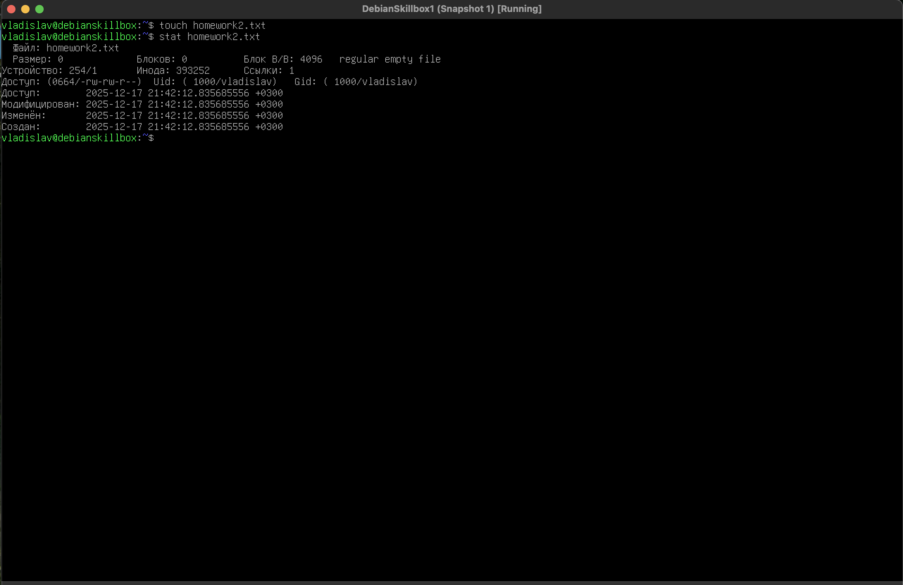
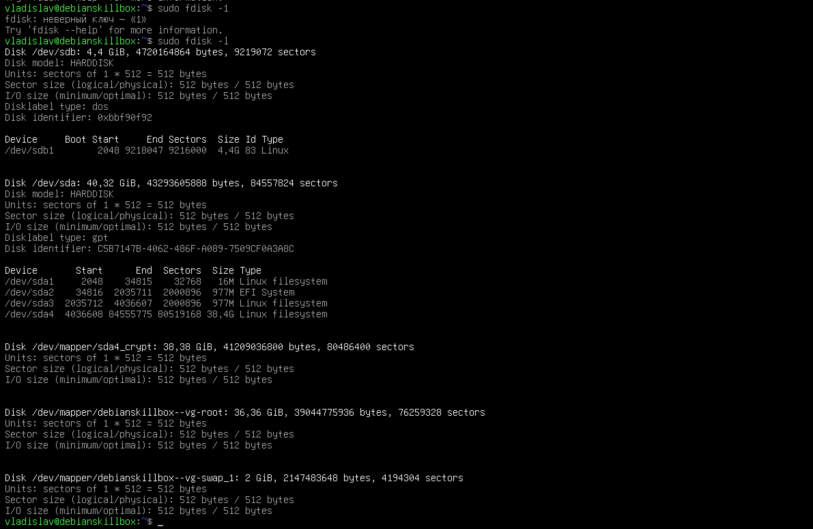
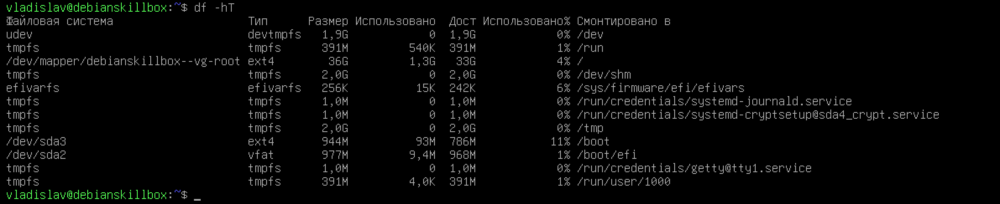
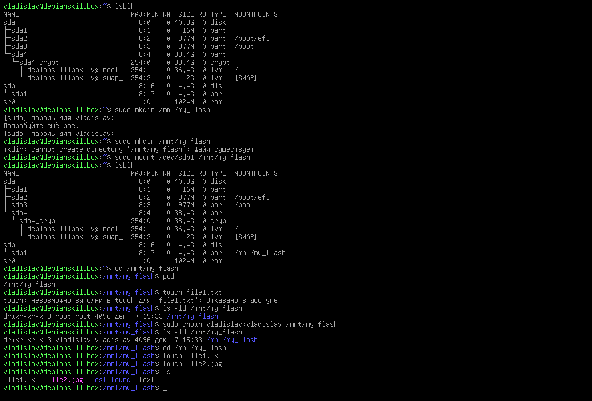
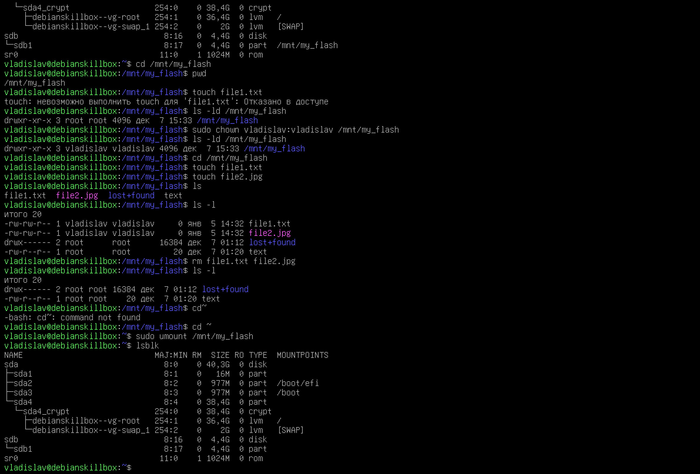
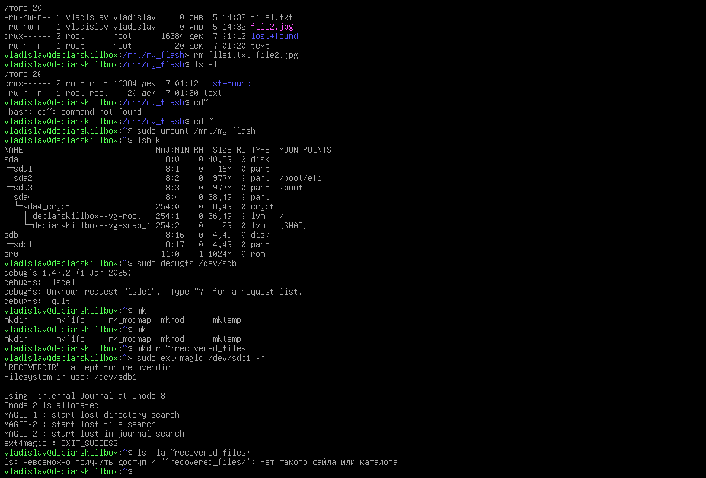

# Практическая работа: Файловая система, inode и восстановление файлов

## 🎯 Цель работы
Изучить структуру файловой системы Linux, получить информацию об inode файла, геометрии разделов, научиться монтировать внешние носители и восстанавливать удалённые файлы.

## 📋 Задание
1. Создать файл и получить подробную информацию об inode.
2. Получить информацию о файловой системе диска и геометрии двух разделов (один с суперблоком).
3. Подмонтировать флешку, создать два файла, удалить их и попытаться восстановить.

## 🛠️ Использованные команды
- touch, stat — создание файла и просмотр inode
- fdisk -l, df -hT, lsblk — информация о дисках и разделах
- mkdir, mount, umount — монтирование флешки
- chown, rm — управление правами и удаление файлов
- debugfs, ext4magic — попытка восстановления файлов

## 📸 Скриншоты

### 1. Создание файла и просмотр inode

touch homework2.txt
stat homework2.txt

### 2. Информация о дисках и разделах

sudo fdisk -l

### 3. Использование файловых систем

df -hT

### 4. Монтирование флешки и создание файлов

sudo mkdir /mnt/my_flash
sudo mount /dev/sdb1 /mnt/my_flash
sudo chown vladislav:vladislav /mnt/my_flash
cd /mnt/my_flash
touch file1.txt
touch file2.jpg
ls

### 5. Удаление файлов и размонтирование

rm file1.txt file2.jpg
ls -l
cd ~
sudo umount /mnt/my_flash
lsblk

### 6. Попытка восстановления файлов

sudo debugfs /dev/sdb1
mkdir ~/recovered_files
sudo ext4magic /dev/sdb1 -r
ls -la ~/recovered_files/

Восстановление не удалось из-за особенностей файловой системы. Процесс изучен, шаги выполнены.

## 📊 Выводы
- Изучена структура inode и способы получения информации о файле.
- Получены навыки работы с fdisk, df, lsblk.
- Освоено монтирование внешних носителей и управление правами.
- Рассмотрены инструменты восстановления (debugfs, ext4magic), выявлены ограничения.
