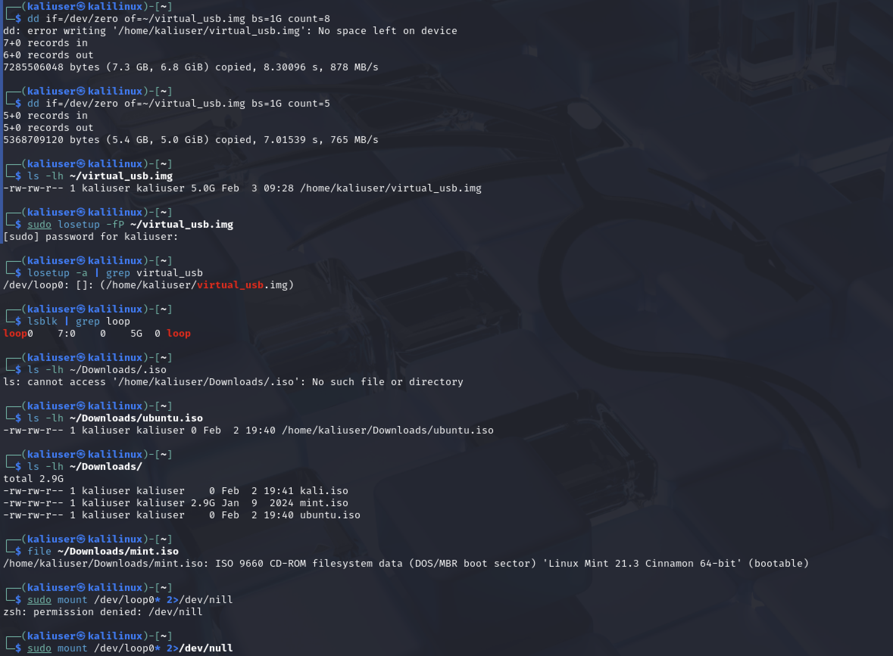
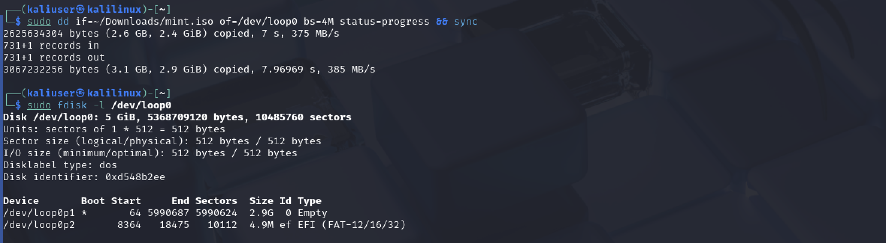

# Практическая работа: Создание загрузочной установочной флешки Linux

## 🎯 Цель работы
Научиться создавать загрузочные установочные флешки Linux: вручную и через графические утилиты.

## 📋 Задание
1. Создать загрузочную установочную флешку Linux вручную.
2. Создать загрузочную установочную флешку Linux через Etcher.
3. (Опционально) Создать UEFI-флешку в Windows через Rufus.

## 🛠️ Использованные команды и инструменты
- dd — создание образа и запись ISO
- losetup — подключение образа как loop-устройства
- lsblk — просмотр блочных устройств
- fdisk -l — просмотр таблицы разделов
- file — определение типа файла

## 📸 Скриншоты

### 1. Создание виртуального USB-образа и проверка ISO

dd if=/dev/zero of=~/virtual_usb.img bs=1G count=5
ls -lh ~/virtual_usb.img
sudo losetup -fP ~/virtual_usb.img
losetup -a | grep virtual_usb
lsblk | grep loop
ls -lh ~/Downloads/
file ~/Downloads/mint.iso

Создан образ 5 ГБ, подключён как /dev/loop0. В папке Downloads найдены ISO-образы, mint.iso — загрузочный образ Linux Mint 21.3 Cinnamon 64-bit.

### 2. Запись ISO на loop-устройство и проверка разделов

sudo dd if=~/Downloads/mint.iso of=/dev/loop0 bs=4M status=progress && sync
sudo fdisk -l /dev/loop0

ISO записан на /dev/loop0. Появились два раздела: loop0p1 (загрузочный, 2.9G) и loop0p2 (EFI, 4.9M).

## ⚠️ Про способ с Etcher

Способ с Etcher выполнить не удалось: программа не видела USB-устройство при работе в виртуальной машине UTM на Mac M1. Проблема связана с пробросом физических USB в виртуалку, а не с самой утилитой. Ручной способ через dd и losetup оказался рабочим.

## 📊 Выводы
- Освоен ручной способ создания загрузочного образа через dd и losetup.
- Изучено подключение файла-образа как блочного устройства.
- Отработана запись ISO и проверка разделов через fdisk.
- Выявлена проблема проброса USB в UTM на Mac M1.
