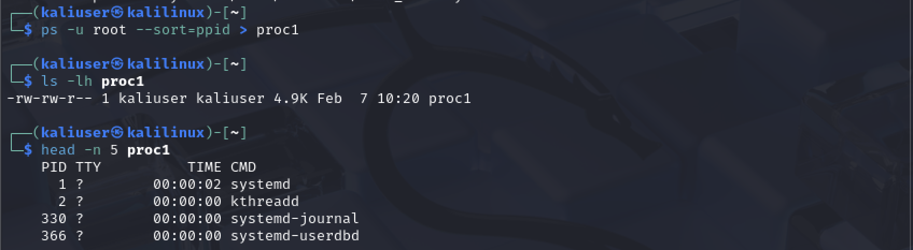
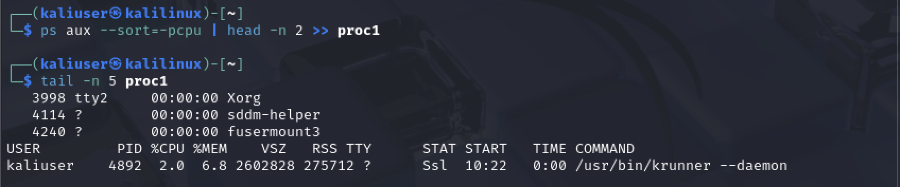
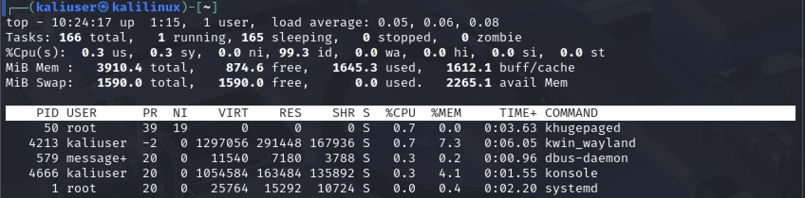
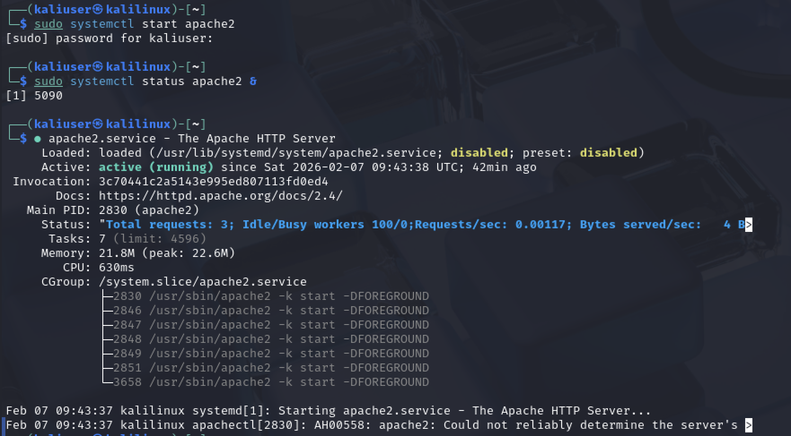
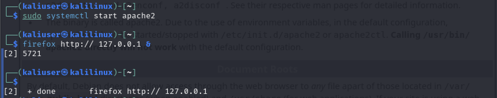
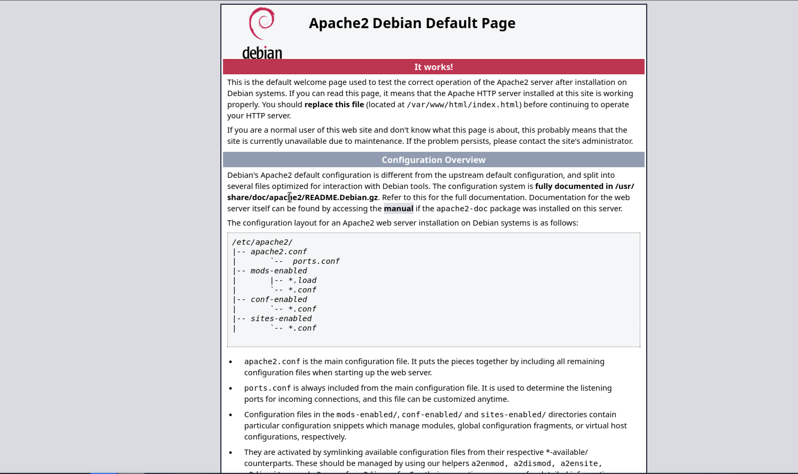

# Практическая работа: Работа с процессами в Linux

## 🎯 Цель работы
Освоить работу с процессами в Linux: просмотр, сортировка, управление, работа с фоновыми задачами и службами.

## 📋 Задание
1. Создать файл proc1 со списком процессов root, отсортированных по PPID.
2. Добавить в proc1 сведения о процессе, потребляющем больше всего CPU.
3. Запустить top, изучить информационные поля.
4. Установить и запустить веб-сервер Apache.
5. Запустить status в фоне, перевести в передний план через fg, проверить active (running).
6. Открыть 127.0.0.1 в браузере.
7. Выполнить killall -u и описать результат.

## 🛠️ Использованные команды
- ps — просмотр процессов
- ps aux, ps -u, --sort — сортировка по PID, PPID, CPU
- head, tail — просмотр начала и конца файла
- top — мониторинг ресурсов в реальном времени
- apt install — установка пакетов
- systemctl start/status — управление службами
- & — запуск в фоне
- jobs, fg — работа с фоновыми задачами
- killall — завершение процессов пользователя
- firefox — открытие браузера

## 📸 Скриншоты

### 1. Список процессов root, сортировка по PPID

ps -u root --sort=ppid > proc1
ls -lh proc1
head -n 5 proc1

Вывод: systemd (PID 1), kthreadd (PID 2), systemd-journal (PID 330), systemd-userdbd (PID 366).

### 2. Добавление процесса с максимальной загрузкой CPU

ps aux --sort=-pcpu | head -n 2 >> proc1
tail -n 5 proc1

В файл proc1 добавлен процесс с максимальной загрузкой CPU: /usr/bin/krunner --daemon (PID 4892, CPU 2.0%, MEM 6.8%).

### 3. Утилита top

top

Информационные поля:
- uptime: 1:15
- users: 1
- load average: 0.05, 0.06, 0.08
- Tasks: 166 total, 1 running, 165 sleeping
- CPU: 0.3 us, 0.3 sy, 99.3 id
- Mem: 3910.4 total, 874.6 free, 1645.3 used
- Swap: 1590.0 total, 1590.0 free

Топ процессов: khugepaged, kwin_wayland, dbus-daemon, konsole, systemd.

### 4. Установка и запуск Apache

sudo apt install apache2
sudo systemctl start apache2
sudo systemctl status apache2 &

Служба apache2 запущена, статус active (running).

### 5. Работа с фоновыми задачами

sudo systemctl status apache2; sleep 60 &
jobs
fg

Задача переведена в фон, затем возвращена в передний план через fg. В выводе видно: Active: active (running).

### 6. Открытие 127.0.0.1 в браузере

firefox http://127.0.0.1 &

Запущен браузер Firefox, открыт локальный веб-сервер.

### 7. Страница Apache по умолчанию

На странице 127.0.0.1 отображается Apache2 Debian Default Page с надписью «It works!». Веб-сервер работает корректно.

### 8. Завершение процессов пользователя

sudo killall -u kaliuser

После выполнения команды все процессы пользователя kaliuser были завершены. Произошёл выход из учётной записи — вернулся на экран входа в систему.

## 📊 Выводы
- Освоена работа с ps и его ключами (-u, aux, --sort).
- Изучены информационные поля утилиты top.
- Отработано управление службами через systemctl.
- Освоена работа с фоновыми задачами (jobs, fg, &).
- Понят принцип действия killall -u: завершает все процессы указанного пользователя, что приводит к выходу из сессии.
