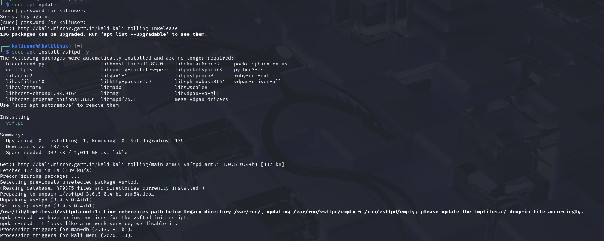
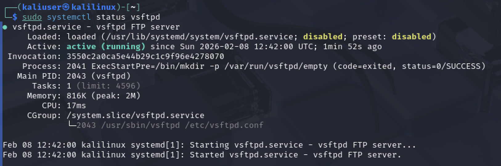
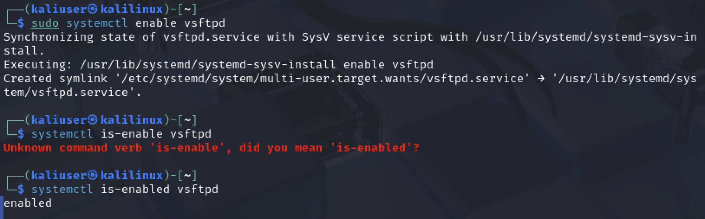
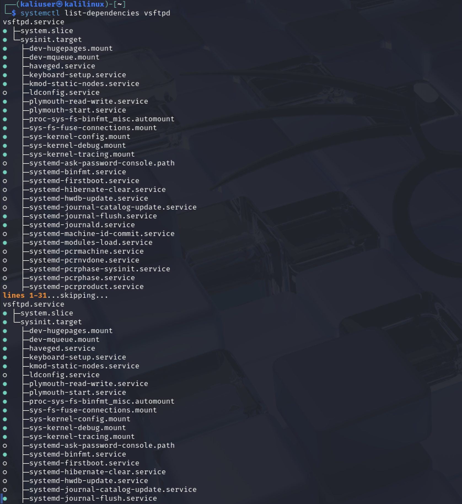
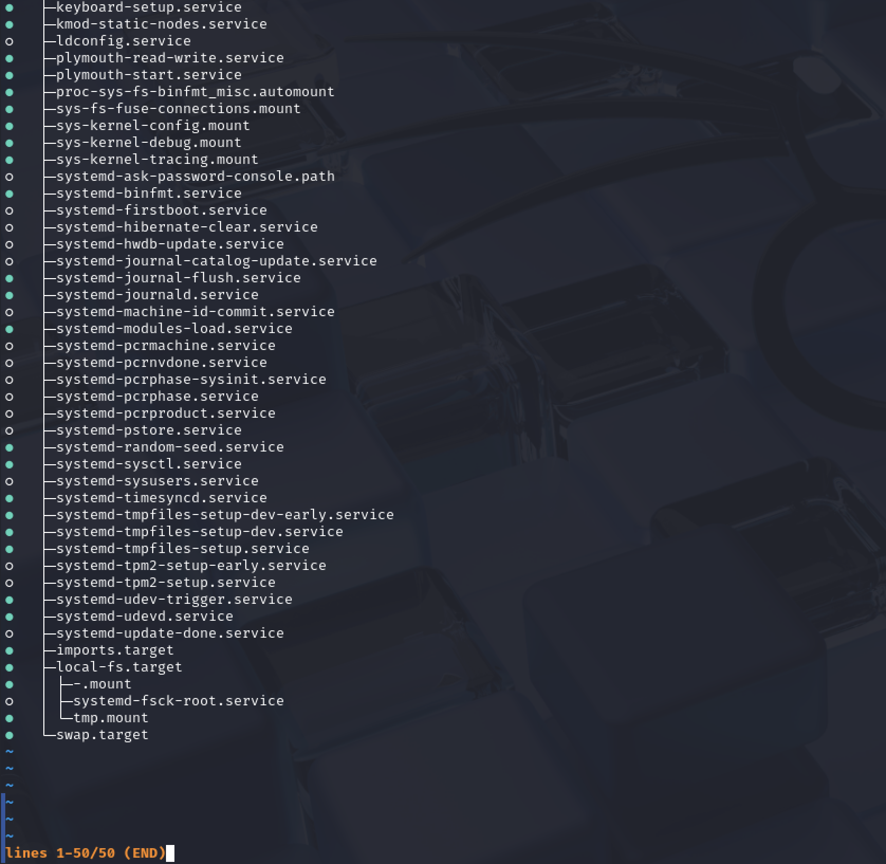

# Практическая работа: Управление службами через systemd

## 🎯 Цель работы
Получить навыки управления системными службами Linux посредством systemd.

## 📋 Задание
1. Проверить статус vsftpd через systemctl — показать, что служба не установлена.
2. Установить vsftpd.
3. Запустить службу.
4. Проверить статус — должна быть active (running).
5. Добавить службу в автозапуск.
6. Вывести список зависимостей юнита vsftpd.

## 🛠️ Использованные команды
- systemctl status — проверка статуса службы
- systemctl start — запуск службы
- systemctl enable — добавление в автозапуск
- systemctl is-enabled — проверка автозапуска
- systemctl list-dependencies — список зависимостей юнита
- apt update, apt install — установка пакетов

## 📸 Скриншоты

### 1. Проверка статуса vsftpd (служба не установлена)

systemctl status vsftpd

Вывод: Unit vsftpd.service could not be found — служба не установлена.

### 2. Установка vsftpd

sudo apt update
sudo apt install vsftpd -y

Пакет vsftpd успешно установлен.

### 3. Запуск службы

sudo systemctl start vsftpd
sudo systemctl status vsftpd --no-pager | grep "Active"

Вывод: Active: active (running) since Sun 2026-02-08 12:42:00 UTC; 1min 1s ago.

### 4. Полный статус службы

sudo systemctl status vsftpd

Служба загружена (loaded), активна (active running). Main PID: 2043 (vsftpd). Memory: 816K.

### 5. Добавление в автозапуск

sudo systemctl enable vsftpd
systemctl is-enabled vsftpd

Создана символическая ссылка /etc/systemd/system/multi-user.target.wants/vsftpd.service. Команда is-enabled вернула: enabled.

### 6. Список зависимостей юнита

systemctl list-dependencies vsftpd

Юнит vsftpd зависит от system.slice и sysinit.target. В дереве видны: dev-hugepages.mount, keyboard-setup.service, systemd-journald.service, systemd-modules-load.service, local-fs.target, swap.target и другие.

### 7. Конец списка зависимостей

systemctl list-dependencies vsftpd (продолжение)

Всего 50 строк. Зависимости включают systemd-tmpfiles-setup.service, systemd-udevd.service, systemd-random-seed.service, swap.target.

## 📊 Выводы
- Освоена работа с systemctl для управления службами.
- Отработаны команды status, start, enable, is-enabled.
- Изучено понятие зависимостей юнита через list-dependencies.
- Проверен полный жизненный цикл службы: установка → запуск → автозапуск → анализ зависимостей.
