# Практическая работа: Логирование, открытые файлы и мониторинг

## 🎯 Цель работы
Освоить работу с логированием в Linux, научиться искать открытые файлы и процессы, познакомиться с утилитами мониторинга.

## 📋 Задание
1. Поиск открытых файлов через lsof.
2. Отображение вызовов приложений через ltrace.
3. Работа с логами через rsyslog.

## 🛠️ Использованные команды и утилиты
- useradd, chpasswd, chown — создание и настройка пользователей
- lsof — список открытых файлов и сокетов
- ltrace — трассировка библиотечных вызовов
- rsyslog — система логирования
- logger — запись сообщений в системный журнал
- systemctl — управление службами

---

## 📸 Задание 1. Поиск открытых файлов

### 1. Создание трёх пользователей

sudo useradd -m -s /bin/bash alice
sudo useradd -m -s /bin/bash bob
sudo useradd -m -s /bin/bash charlie
echo "alice:123" | sudo chpasswd
echo "bob:123" | sudo chpasswd
echo "charlie:123" | sudo chpasswd
sudo chown -R alice:alice /home/alice
sudo chown -R bob:bob /home/bob
sudo chown -R charlie:charlie /home/charlie

Созданы три пользователя: alice, bob, charlie. Для каждого задан пароль и установлен владелец домашнего каталога.

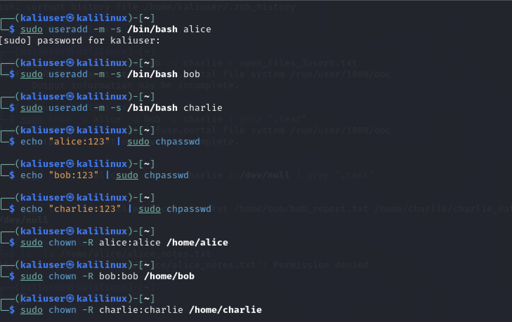

### 2. Открытие файлов от имени каждого пользователя

Файлы созданы и открыты в редакторе nano:

- /home/alice/alice_notes.txt — содержимое "Hello"
- /home/bob/bob_report.txt — содержимое "ciao"
- /home/charlie/charlie_data.txt — содержимое "11.02.26"

### 3. Установка утилиты lsof

sudo apt install lsof -y

Утилита lsof уже установлена (newest version 4.99.4).

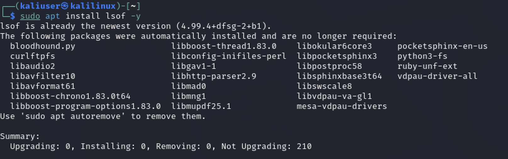

### 4. Список открытых файлов пользователя alice

sudo lsof -u alice

В выводе видны открытые файлы процессов пользователя alice: системные библиотеки (/usr/lib/aarch64-linux-gnu/...), сам редактор nano (PID 6105), открытые файлы в /home/kaliuser, сокеты /dev/pts/1, memfd и др.

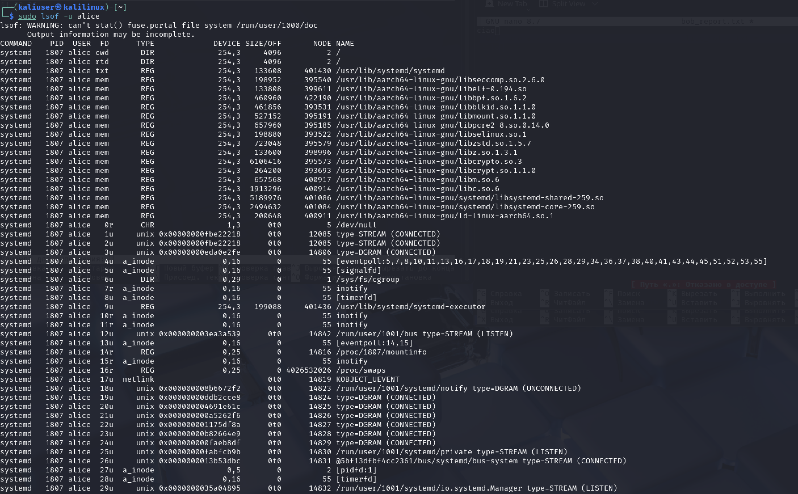

### 5. Список открытых сетевых сокетов

sudo lsof -i -P -n | head -30

В выводе видны сетевые соединения:
- NetworkManager (PID 660) — UDP 192.168.64.14:68 → 192.168.64.1:67 (DHCP-клиент).
- vsftpd (PID 758) — TCP *:21 (LISTEN) — FTP-сервер слушает порт 21.

**Предположение по расследованию:**
Открытый порт 21 (FTP) — классический вектор атаки: FTP передаёт данные и учётные данные в открытом виде, если не используется FTPS. Если злоумышленник получил доступ к этому сервису, он мог выкачать файлы пользователей. DHCP-сокет безопасен — это служебный трафик.

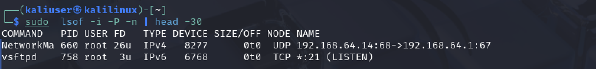

---

## 📸 Задание 2. Отображение вызовов приложений

### 6. Установка утилиты ltrace

sudo apt update
sudo apt install ltrace -y
ltrace --version

Установлена утилита ltrace версии 0.7.91.

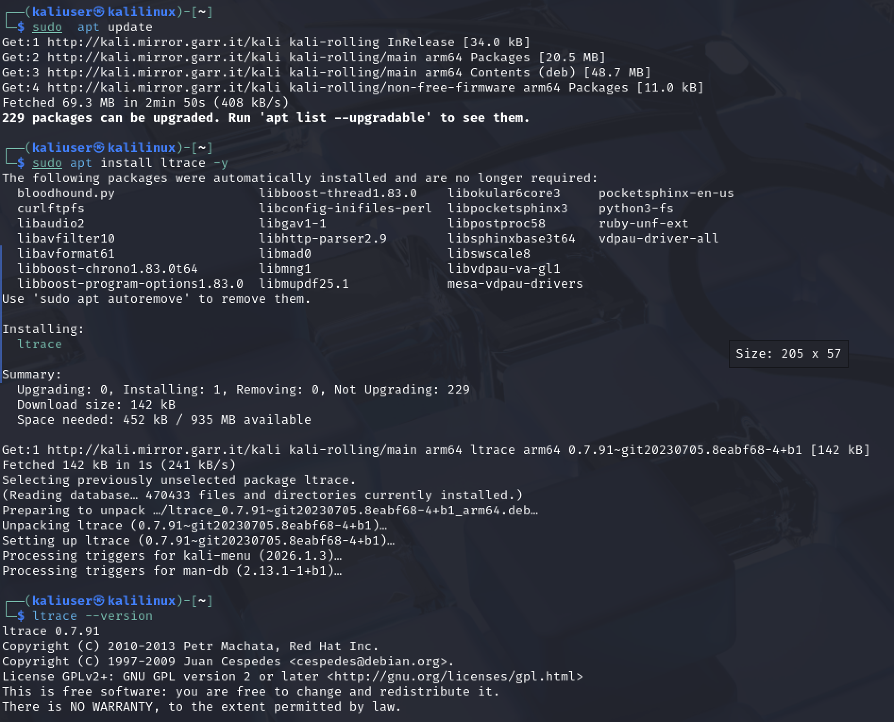

### 7. Пояснение утилиты ltrace

**ltrace** — утилита для трассировки (перехвата и записи) вызовов динамических библиотечных функций. Когда программа работает, она вызывает функции из системных библиотек, и ltrace показывает эти вызовы в реальном времени.

**Для чего нужна:**
- Отладка программ — если программа работает не так, можно увидеть, на каком вызове происходит ошибка.
- Анализ вредоносного ПО — многие вирусы используют недокументированные вызовы, ltrace помогает их обнаружить.
- Понимание поведения программы — какие файлы открывает, какие функции библиотек вызывает.

**Когда использовать:**
- При подозрении, что программа делает что-то скрытное.
- Когда нужно понять, какие файлы открывает программа.
- При оптимизации производительности — какие библиотечные функции вызываются чаще всего.

### 8. Запуск ltrace

ltrace echo "test" | head -5

В выводе видны библиотечные вызовы программы echo:
- __cxa_atexit
- __fpending
- free
- __ctype_get_mb_cur_max
- realloc
- __stack_chk_fail
- __assert_fail
- nl_langinfo
- malloc
- getenv("test")
- setlocale
- bindtextdomain("test\n")
- __printf_chk
- fclose

Это показывает, какие функции библиотек вызывает echo при работе. Так можно отследить даже скрытые процессы.

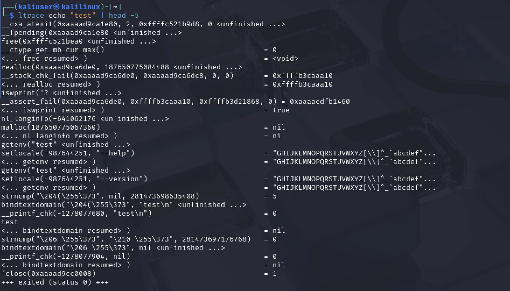

---

## 📸 Задание 3. Работа с логами

### 9. Установка сервиса rsyslog

sudo apt install rsyslog -y

Установлены пакеты: rsyslog, libestr0, libfastjson4, liblognorm5.

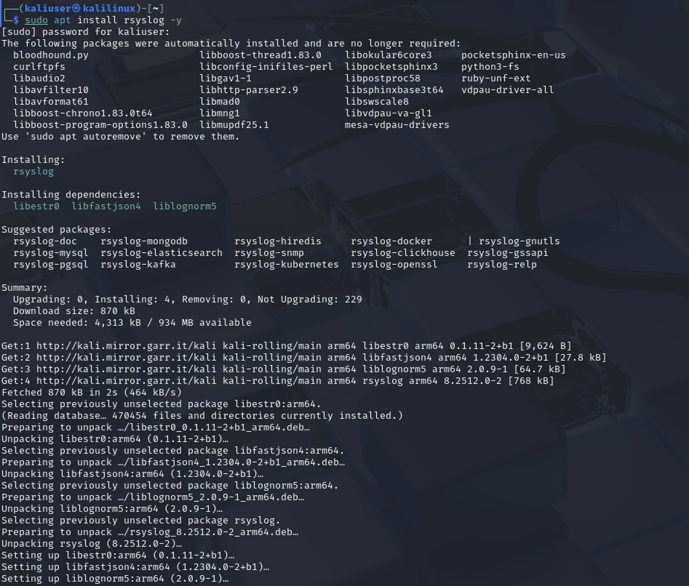

### 10. Установка и настройка rsyslog

После установки созданы символические ссылки:
- /etc/systemd/system/syslog.service → /usr/lib/systemd/system/rsyslog.service
- /etc/systemd/system/multi-user.target.wants/rsyslog.service

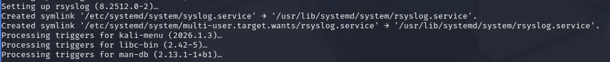

### 11. Запуск и проверка статуса rsyslog

sudo systemctl start rsyslog
sudo systemctl enable rsyslog
sudo systemctl status rsyslog --no-pager | head -10

Статус: active (running) since Thu 2026-02-12 09:58:44 UTC. Loaded: enabled. Main PID: 7366 (rsyslogd).

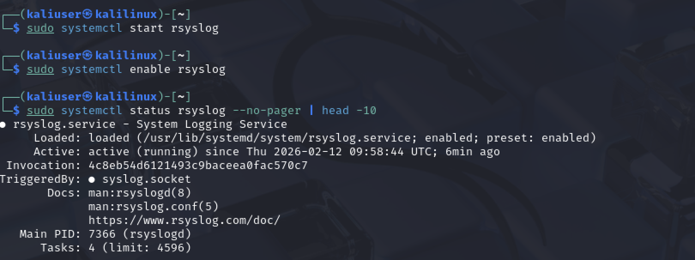

### 12. Настройка rsyslog

sudo nano /etc/rsyslog.d/50-user.conf

Содержимое файла:
user.* /var/log/user.log

Это правило означает: все сообщения с приоритетом user.* записывать в файл /var/log/user.log.

sudo systemctl restart rsyslog

Служба перезапущена с новой конфигурацией.

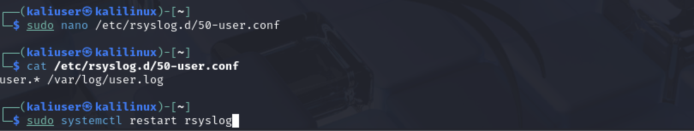

### 13. Запись и проверка сообщения в логе

logger -p user.info "Мое первое сообщение в user.log"
sudo tail -5 /var/log/user.log

В логе появилась запись:
2026-02-12T10:15:30.687733+00:00 kalilinux kaliuser: Мое первое сообщение в user.log

**Краткое описание результата:**
Сервис rsyslog работает, ошибок нет. Конфигурация корректна: сообщения с приоритетом user.info записываются в отдельный лог-файл /var/log/user.log. Команда logger успешно отправила тестовое сообщение, и оно появилось в логе.

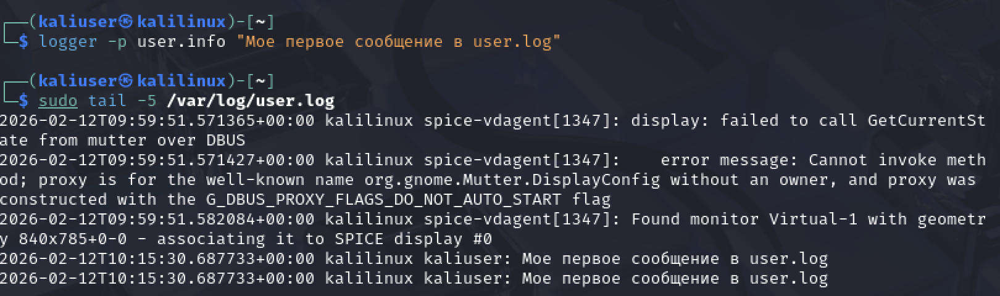

---

## 📊 Выводы
- Освоена работа с утилитой lsof: поиск открытых файлов и сетевых сокетов.
- Изучена утилита ltrace для трассировки библиотечных вызовов.
- Настроен rsyslog с отдельным лог-файлом для сообщений пользователя.
- Отработаны навыки расследования: от создания пользователей до анализа логов.
- Понят принцип работы логирования и мониторинга в Linux.

## 🧠 Ответы на вопросы задания
- **Какое приложение с открытым портом могло позволить злоумышленнику пробраться?** — vsftpd на порту 21 (FTP). FTP передаёт данные без шифрования, что делает его уязвимым.
- **Для чего нужна ltrace?** — для трассировки вызовов динамических библиотек: отладка, анализ вредоносного ПО, понимание поведения программы.
- **Что выводится на экран при работе rsyslog?** — статус службы (active running), а после настройки и записи через logger — сообщения в /var/log/user.log.
