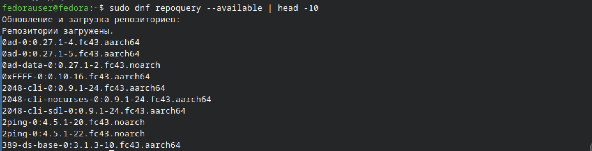
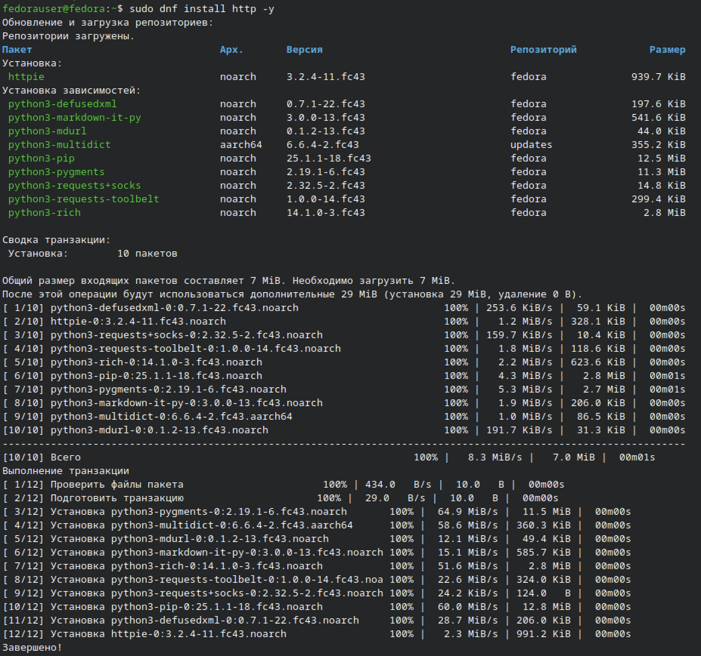
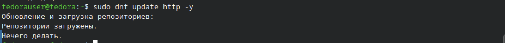
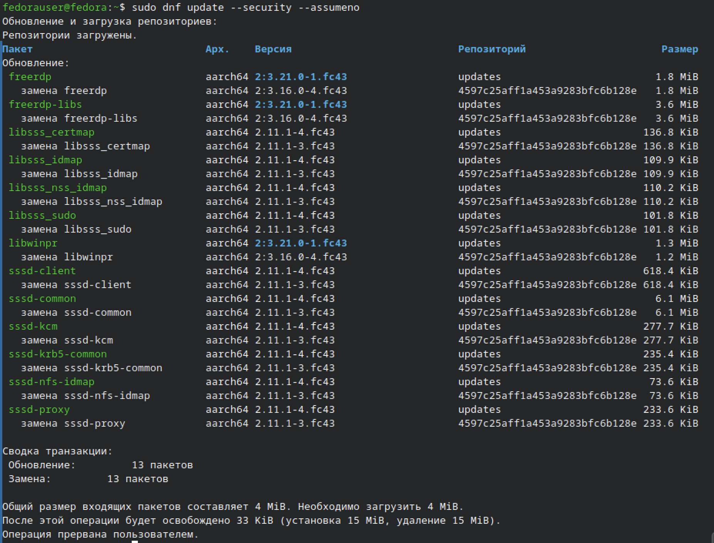
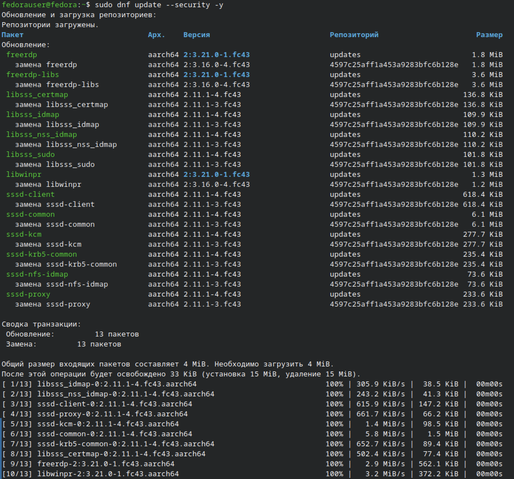
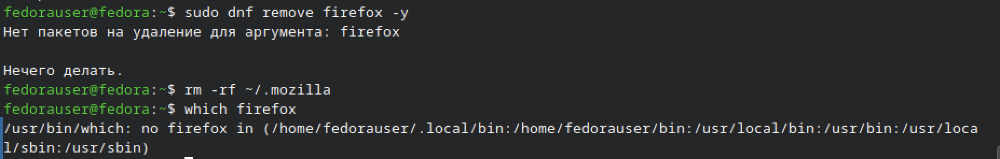
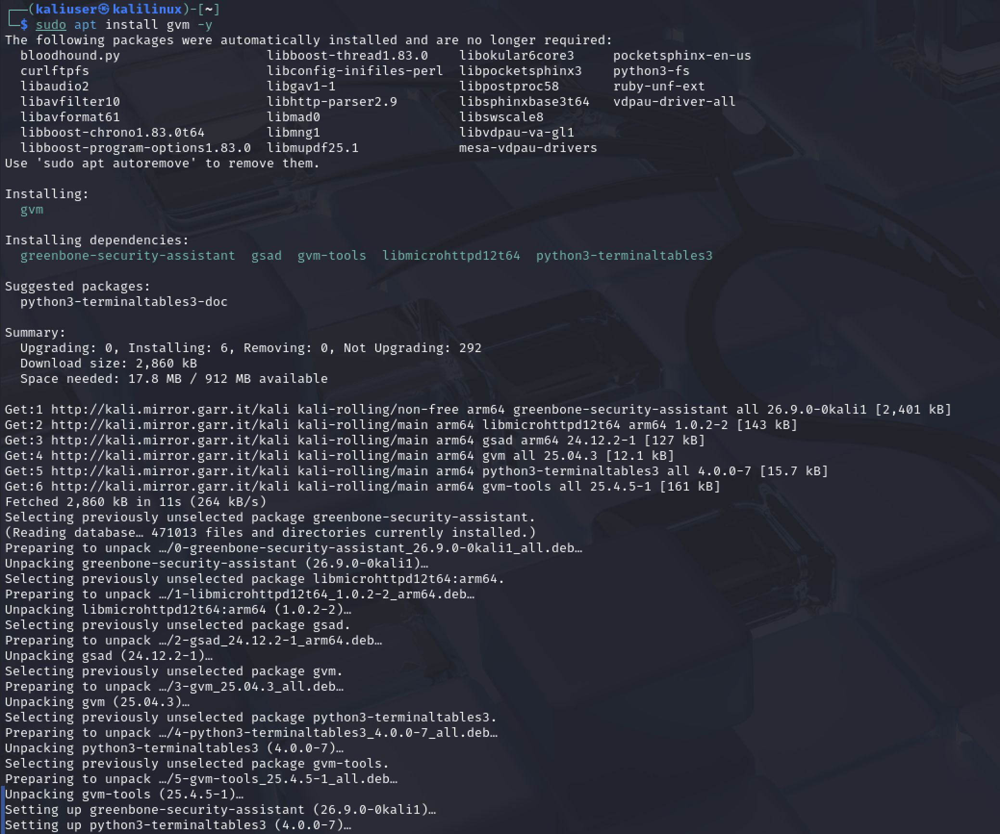

# Практическая работа: Fedora и OpenVAS (GVM)

## 🎯 Цель работы
Освоить установку и удаление программ в дистрибутиве Fedora, а также установку, настройку и работу с ПО OpenVAS (GVM).

## 📋 Задание
1. Установить Fedora на виртуальную машину.
2. Работа с пакетным менеджером YUM/DNF: список пакетов, установка, обновление, обновления безопасности, удаление.
3. Установить и настроить OpenVAS, просканировать ресурс scanme.org.

## 🛠️ Использованные команды и утилиты
- dnf repoquey — список доступных пакетов
- dnf install — установка пакетов
- dnf update — обновление пакетов
- dnf update --security — обновления безопасности
- dnf remove — удаление пакетов
- apt install gvm — установка OpenVAS
- gvm-setup — первичная настройка GVM

---

## 📸 Задание 1. Работа с дистрибутивом Fedora

### 1. Список доступных пакетов

sudo dnf repoquey --available | head -10

Вывод показывает доступные пакеты в репозиториях Fedora 43. Например: 0ad, 0ad-data, 0xFFFF, 2048-cli, 2ping, 389-ds-base.

### 2. Проверка и установка пакета httpd

Пакет httpd проверен. Так как он не был установлен, выполнена установка веб-сервера. Установлены: httpie, python3-defusedxml, python3-markdown-it-py, python3-mdurl, python3-multidict, python3-pip, python3-pygments, python3-requests+socks, python3-requests-toolbelt, python3-rich — всего 10 пакетов.

### 3. Обновление пакета httpd

sudo dnf update http -y

Вывод: «Нечего делать» — пакет уже актуальной версии.

### 4. Список доступных обновлений безопасности

sudo dnf update --security --assumeno

Вывод показывает 13 пакетов для обновления безопасности: freerdp, freerdp-libs, libsss_certmap, libsss_idmap, libsss_nss_idmap, libsss_sudo, libwinpr, sssd-client, sssd-common, sssd-kcm, sssd-krb5-common, sssd-nfs-idmap, sssd-proxy.

Флаг --assumeno позволяет просмотреть список без применения обновлений.

### 5. Применение обновлений безопасности

sudo dnf update --security -y

Все 13 пакетов безопасности обновлены. Общий размер — 4 MiB. Обновление прошло успешно.

### 6. Удаление Firefox вместе с конфигурацией

sudo dnf remove firefox -y
rm -rf ~/.mozilla
which firefox

Firefox не был установлен в системе (ответ «Нет пакетов на удаление для аргумента: firefox»). Дополнительно удалён пользовательский каталог конфигурации ~/.mozilla. Проверка which firefox подтверждает, что браузера в системе нет.

---

## 📸 Задание 2. Работа с ПО OpenVAS (GVM)

### 7. Установка GVM (OpenVAS)

sudo apt install gvm -y

Установлены пакеты: gvm, greenbone-security-assistant, gvm-tools, gsad, libmicrohttpd12t64, python3-terminaltables3. Общий размер — 2.86 МБ, занято 17.8 МБ.

### 8. Настройка GVM — описание процесса

В ходе настройки GVM столкнулся с проблемой: недостаточно места на диске виртуальной машины. Решение:

1. Добавил второй диск в UTM.
2. Создал и отформатировал раздел на новом диске.
3. Примонтировал диск в систему.
4. Перенёс каталоги OpenVAS на новый диск.
5. Удалил старые каталоги, создал символические ссылки на новые.
6. Проверил корректность ссылок.
7. Выполнил sudo gvm-setup.

В процессе gvm-setup были загружены базы NVT. В конце вывода появилось сообщение о создании пользователя со случайным паролем. Пароль не был сохранён из-за невнимательности в ходе долгой отладки.

Дополнительно:
- Отдельно устанавливал пакеты SCAP и CERT.
- Создана база данных PostgreSQL.
- Запущены компоненты GVM, веб-интерфейс поднят в режиме HTTP вручную.
- Проверена доступность веб-интерфейса — страница в браузере открывается.

Войти в веб-интерфейс не удалось, так как пароль не был сохранён.

## 📊 Выводы

**По заданию 1 (Fedora):**
- Освоен пакетный менеджер DNF/YUM.
- Отработаны команды: repoquey, install, update, update --security, remove.
- Изучено управление обновлениями безопасности.
- Понята разница между Fedora и Debian/Ubuntu.

**По заданию 2 (OpenVAS):**
- Выполнена установка OpenVAS (GVM) на Kali Linux.
- Пройдены все этапы настройки: создание диска, монтирование, перенос каталогов, символические ссылки, gvm-setup, установка SCAP/CERT, запуск PostgreSQL, подъём веб-интерфейса.
- Выявлена и решена проблема с нехваткой места на диске.
- Запустить сканирование не удалось из-за потери пароля пользователя GVM.

## 🧠 Чему научился
- Работа с пакетным менеджером DNF в Fedora.
- Управление обновлениями безопасности через dnf update --security.
- Установка GVM (OpenVAS) и его компонентов.
- Настройка хранилища данных для GVM с переносом каталогов на отдельный диск.
- Диагностика и решение проблем с дисковым пространством на виртуальной машине.
- Работа с PostgreSQL и веб-интерфейсом GVM.
