# Практическая работа: Базовая и продвинутая настройка безопасности Linux

## 🎯 Цель работы
Освоить базовые и продвинутые настройки безопасности Linux: политика паролей, ограничение домашнего каталога, брандмауэр, отключение root-логина по SSH, AppArmor.

## 📋 Задание
1. Базовая настройка: пароли, вход по паролю, ограничение домашнего каталога, брандмауэр, запрет SSH от root.
2. Продвинутая настройка: AppArmor, отключение профиля Firefox.

## 🛠️ Использованные команды и утилиты
- passwd -S — проверка статуса пароля пользователя
- chmod — изменение прав доступа
- ufw — брандмауэр
- systemctl — управление службами
- sshd_config — конфигурация SSH
- apparmor, aa-status — система контроля доступа
- apparmor-utils — утилиты для работы с профилями

---

## 📸 Задание 1. Базовая настройка безопасности

### 1. Проверка статуса пароля

passwd -S $USER

Вывод: `kaliuser P 2026-02-02 0 99999 7 -1`. Статус `P` означает, что пароль установлен. Срок действия: 0-99999 дней, предупреждение за 7 дней.

**Требования к безопасному паролю (инструкция):**
- Минимальная длина: 12 символов.
- Обязательно: заглавные и строчные буквы, цифры, специальные символы.
- Не использовать словарные слова и личные данные.
- Менять пароль не реже 1 раза в 90 дней.
- Не повторять последние 5 паролей.

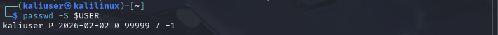

### 2. Проверка настроек входа по паролю

sudo cat /etc/lightdm/lightdm.conf | grep -i autologin
ls -la /etc/lightdm/lightdm.conf.d/
cat /etc/lightdm/lightdm.conf.d/01_kali.conf

В конфигурации lightdm не обнаружено autologin. Значит, вход по паролю включён. Файл 01_kali.conf содержит параметр session-wrapper.

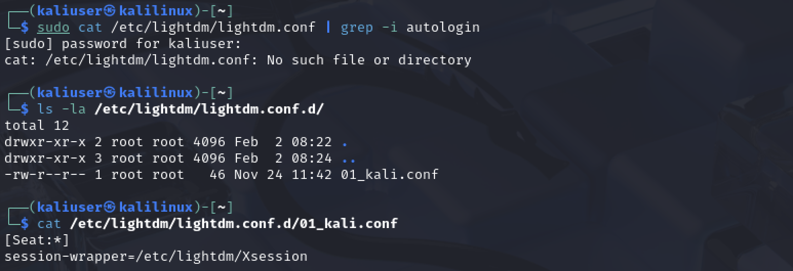

### 3. Ограничение домашнего каталога

chmod 700 /home/kaliuser
ls -ld /home/kaliuser

Права изменены на `drwx------`. Теперь только владелец имеет доступ к своему домашнему каталогу.

### 4. Установка брандмауэра UFW

sudo apt update
sudo apt install ufw -y

Брандмауэр UFW установлен. Созданы конфигурационные файлы: /etc/ufw/before.rules, after.rules, before6.rules, after6.rules.

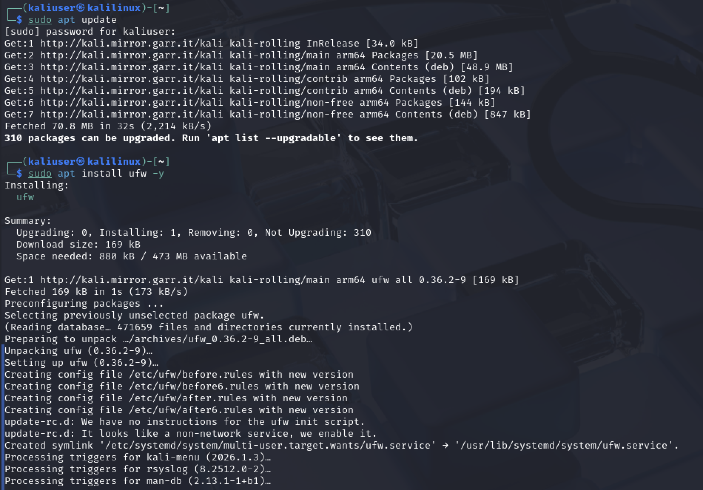

### 5. Настройка политик по умолчанию

sudo ufw default deny incoming
sudo ufw default allow outgoing

Входящие соединения запрещены, исходящие — разрешены.

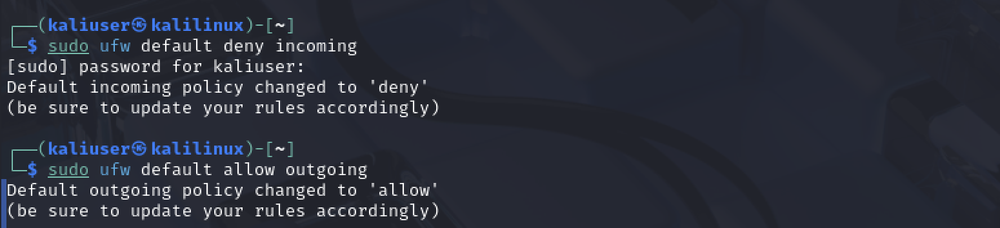

### 6. Разрешение SSH и включение UFW

sudo ufw allow ssh
sudo ufw enable
sudo ufw status verbose

UFW активен. Правило: 22/tcp ALLOW IN из любого источника. Политика: deny (incoming), allow (outgoing).

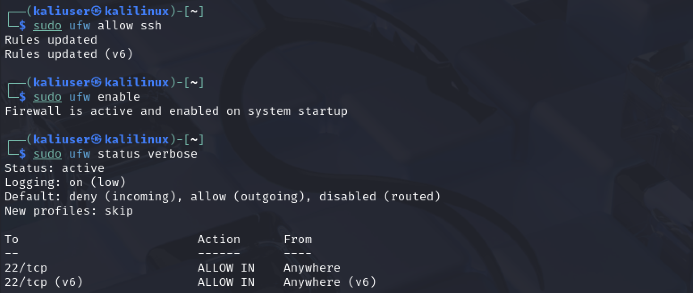

### 7. Проверка статуса SSH

sudo systemctl status ssh

Служба SSH не запущена: Active: inactive (dead), disabled.

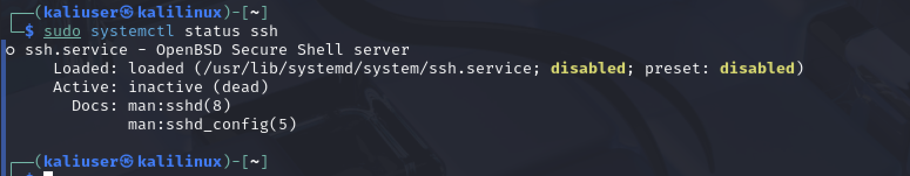

### 8. Установка и запуск SSH

sudo apt install ssh -y
sudo systemctl start ssh
sudo systemctl enable ssh
sudo systemctl status ssh

SSH установлен, запущен и добавлен в автозапуск. Статус: active (running), Main PID 3854. Сервер слушает порт 22.

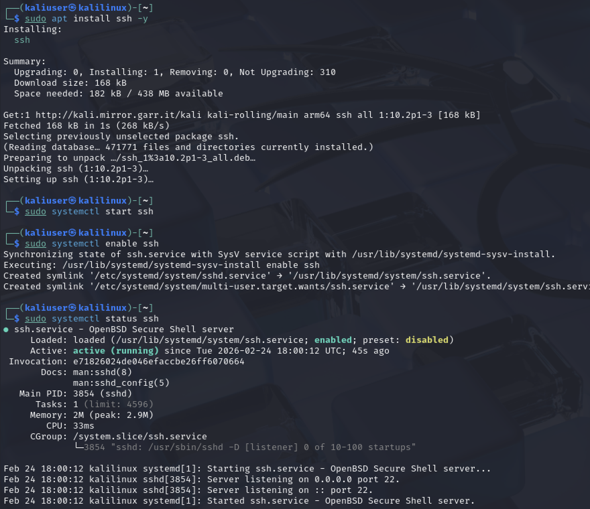

### 9. Редактирование конфигурации SSH

sudo nano /etc/ssh/sshd_config

Открыт файл конфигурации SSH для отключения входа от root.

### 10. Начальная строка PermitRootLogin

В файле обнаружена закомментированная строка:

#PermitRootLogin prohibit-password

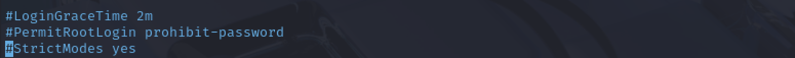

### 11. Правка строки PermitRootLogin

Строка изменяется с закомментированной на активную.

### 12. Установлено PermitRootLogin no

PermitRootLogin no

Теперь вход по SSH от имени root полностью запрещён.

### 13. Перезапуск SSH и проверка запрета root

sudo systemctl restart ssh
ssh root@localhost

При попытке подключения выведен fingerprint ключа. После подтверждения — запрос пароля.

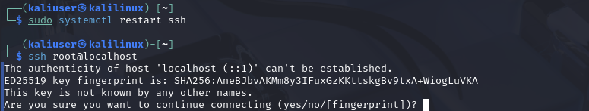

### 14. Результат: доступ root запрещён

При вводе пароля root получено:

Permission denied (publickey,password).

Это подтверждает, что вход по SSH от имени root успешно заблокирован.

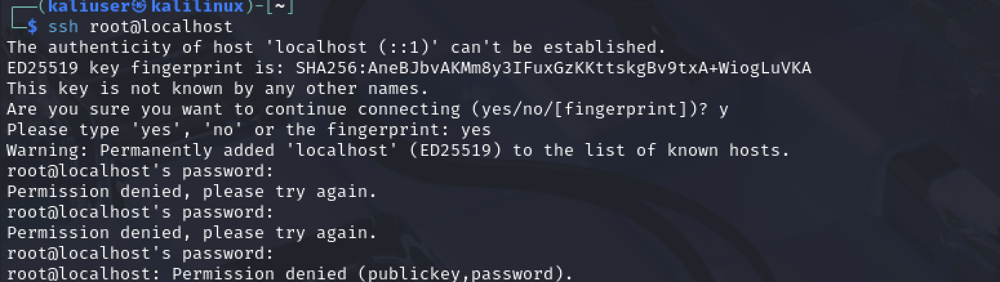

### 15. Проверка архитектуры системы

uname -m

Вывод: aarch64. Система работает на ARM-архитектуре (Mac M1 + UTM).

*Примечание:* утилиту TuxCut установить не удалось — она не поддерживается на ARM (aarch64). Защита от атак «Человек посередине» на этом уровне реализована через UFW и запрет SSH от root.

---

## 📸 Задание 2. Продвинутая настройка безопасности

### 16. Установка AppArmor

sudo apt install apparmor apparmor-profiles -y

AppArmor уже установлен (версия 4.1.3-1). Дополнительно установлены apparmor-profiles.

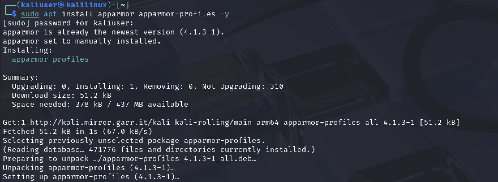

### 17. Проверка статуса AppArmor

sudo aa-status

Вывод: модуль AppArmor загружен. 21 профиль загружен, 0 в enforce mode, 21 в complain mode. Профили: avahi-daemon, dnsmasq, identd, klogd, mdnsd, nmbd, nscd, php-fpm, ping, samba-*, smbd, smbldap-useradd, syslog-ng, syslogd, traceroute.

### 18. Установка apparmor-utils

sudo apt install apparmor-utils -y

Установлены пакеты: apparmor-utils, python3-apparmor, python3-libapparmor. Это набор утилит для управления профилями AppArmor.

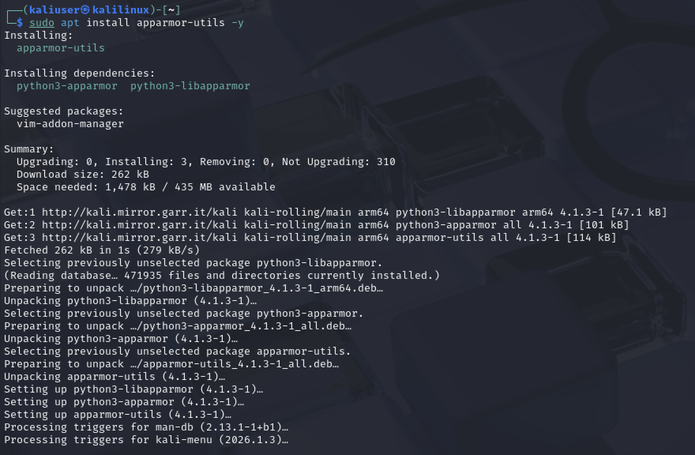

### 19. Проверка профиля Firefox

sudo aa-status | grep firefox

Вывод пустой — профиль Firefox не загружен. Это значит, что Firefox не ограничен профилем AppArmor. Для защиты от утечки данных через браузер рекомендуется либо установить профиль Firefox вручную, либо использовать enforce-режим для браузера.

---

## 📊 Выводы

**Базовая настройка:**
- Проверен статус пароля и составлены требования к безопасному паролю.
- Подтверждён вход по паролю через lightdm (autologin отключён).
- Ограничен домашний каталог (chmod 700).
- Установлен и настроен брандмауэр UFW: deny incoming, allow outgoing, SSH разрешён.
- Установлен SSH, отключён вход от root (PermitRootLogin no), проверено — доступ запрещён.

**Продвинутая настройка:**
- Установлен AppArmor и apparmor-profiles.
- Проверен статус: 21 профиль загружен.
- Установлены apparmor-utils для работы с профилями.
- Проверен профиль Firefox — не загружен, требует дополнительной настройки.

## 🧠 Чему научился
- Работа с UFW: политики, правила, статус.
- Настройка SSH: отключение root-логина, проверка конфигурации.
- Работа с AppArmor: статус, профили, утилиты.
- Ограничение прав доступа к домашнему каталогу.
- Диагностика ограничений на ARM-архитектуре (TuxCut).
