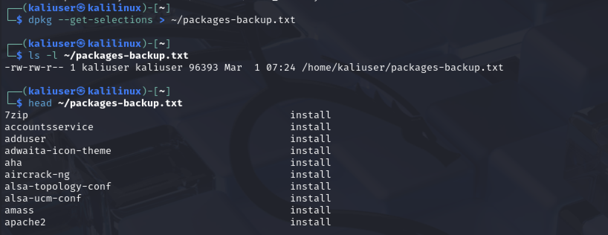
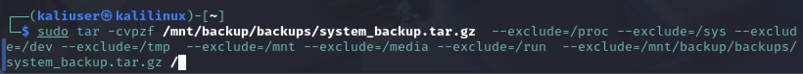
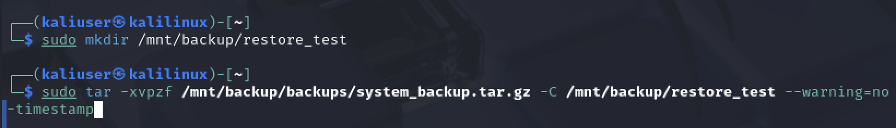
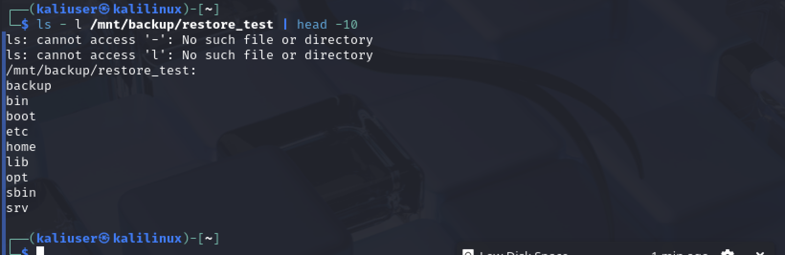

# Практическая работа: Резервное копирование и восстановление данных

## 🎯 Цель работы
Освоить резервное копирование и восстановление данных в Linux: создание бэкапа пакетов через dpkg, полное резервное копирование через tar, восстановление системы из архива.

## 📋 Задание
1. Создать бэкап всех установленных пакетов через dpkg.
2. Сделать полную резервную копию системы через tar.
3. Восстановить систему из архива через tar.

## 🛠️ Использованные команды и утилиты
- dpkg --get-selections — список установленных пакетов
- tar -cvpzf — создание сжатого архива
- tar -xvpfz — извлечение архива
- ls -lh — проверка размера архива

---

## 📸 Задание 1. Резервная копия установленных пакетов

### 1. Создание бэкапа пакетов

dpkg --get-selections > ~/packages-backup.txt
ls -l ~/packages-backup.txt
head ~/packages-backup.txt

Создан файл со списком всех установленных пакетов. Размер — 96393 байта. В начале списка: 7zip, accountsservice, adduser, adwaita-icon-theme, aha, aircrack-ng, alsa-topology-conf, alsa-ucm-conf, amass, apache2 — все с флагом `install`.

Такой бэкап позволяет перенести список пакетов на другую машину и восстановить их командой `dpkg --set-selections` и `apt-get dselect-upgrade`.

---

## 📸 Задание 2. Резервное копирование системы через tar

### 2. Создание полного архива системы

sudo tar -cvpzf /mnt/backup/backups/system_backup.tar.gz \
  --exclude=/proc --exclude=/sys --exclude=/dev \
  --exclude=/tmp --exclude=/mnt --exclude=/media \
  --exclude=/run --exclude=/mnt/backup/backups/system_backup.tar.gz /

Архив создан с исключением служебных и виртуальных каталогов:
- /proc, /sys, /dev — виртуальные ФС (не нужно копировать)
- /tmp, /run — временные данные
- /mnt, /media — внешние и подключённые тома
- Сам архив исключён, чтобы не копировать его в себя

### 3. Проверка размера архива

ls -lh /mnt/backup/backups/system_backup.tar.gz

Размер архива — 14G. Владелец — root:root. Архив создан 1 марта в 08:15.

---

## 📸 Задание 3. Восстановление данных системы

### 4. Восстановление архива в тестовый каталог

sudo mkdir /mnt/backup/restore_test
sudo tar -xvpfz /mnt/backup/backups/system_backup.tar.gz -C /mnt/backup/restore_test --warning=no-timestamp

Архив успешно распакован в каталог /mnt/backup/restore_test. Опция -C указывает каталог назначения, --warning=no-timestamp подавляет предупреждения о временных метках.

### 5. Проверка восстановленных файлов

ls -l /mnt/backup/restore_test | head -10

В каталоге восстановлены: backup, bin, boot, etc, home, lib, opt, sbin, srv. Структура файловой системы восстановлена корректно.

---

## 📊 Выводы
- Освоено создание бэкапа установленных пакетов через dpkg --get-selections.
- Изучена утилита tar для полного резервного копирования системы.
- Отработано исключение служебных каталогов (/proc, /sys, /dev, /tmp, /mnt, /media, /run).
- Освоено восстановление системы из архива в отдельный каталог.
- Понят принцип полного бэкапа Linux и его применения при сбоях.

## 🧠 Чему научился
- Работа с dpkg: получение списка установленных пакетов, сохранение в файл.
- Работа с tar: создание (-cvpzf) и извлечение (-xvpfz) архивов.
- Исключение ненужных каталогов при бэкапе.
- Проверка целостности восстановленных данных.
- Понимание, зачем нужен регулярный бэкап в реальной инфраструктуре.
