# Практическая работа: NFS и анализ DNS-пакетов

## 🎯 Цель работы
Освоить установку и настройку сетевой файловой системы NFS, а также анализ DNS-пакетов с помощью Wireshark.

## 📋 Задание
1. Установить и настроить NFS-сервер и клиент.
2. Проанализировать DNS-пакеты через Wireshark при заходе на skillbox.ru.

## 🛠️ Использованные команды и утилиты
- nfs-kernel-server — сервер NFS
- nfs-common — клиент NFS
- /etc/exports — конфигурация экспорта
- exportfs, showmount — управление и проверка экспорта
- mount — монтирование NFS-шары
- Wireshark — анализатор трафика
- dns.qry.name — фильтр для DNS-запросов

---

## 📸 Задание 1. Установка и настройка NFS

### 1. Установка NFS-сервера

sudo apt install nfs-kernel-server -y

Установлены пакеты: nfs-kernel-server, nfs-common, rpcbind, keyutils, libnfsidmap1. Созданы символические ссылки для автозапуска rpcbind.

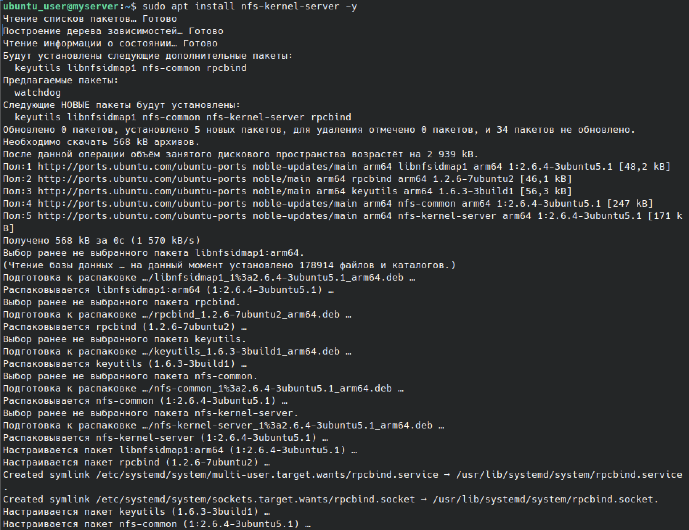

### 2. Настройка NFS-шары

sudo mkdir -p /srv/nfs_share
sudo chown nobody:nogroup /srv/nfs_share
sudo chmod 777 /srv/nfs_share
sudo nano /etc/exports
sudo exportfs -ra
showmount -e localhost

Создана директория /srv/nfs_share, назначен владелец nobody:nogroup, права 777. Экспорт применён, showmount показывает: `/srv/nfs_share *`.

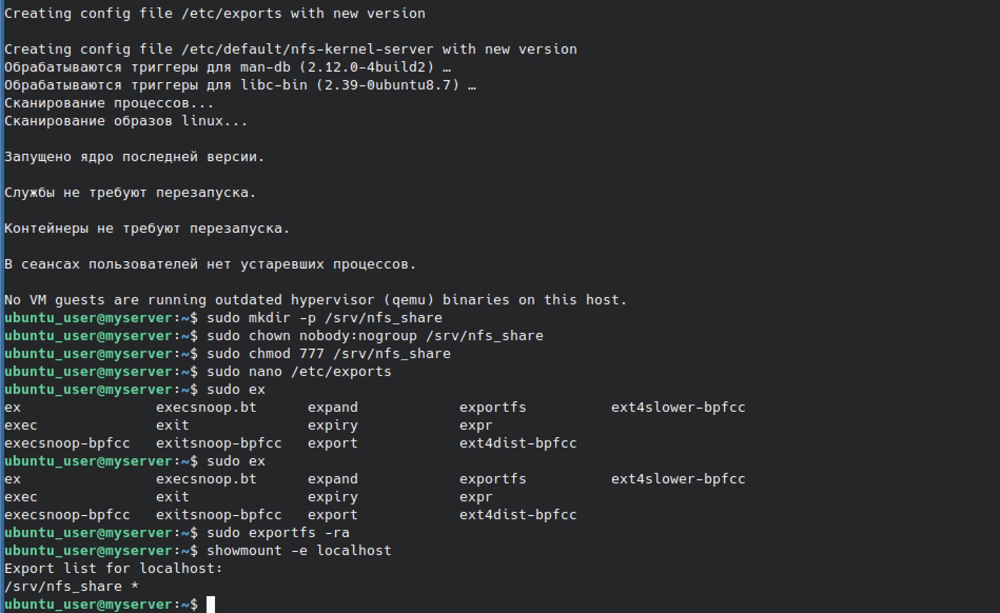

### 3. Конфигурация /etc/exports

Содержимое файла /etc/exports:

/srv/nfs_share *(rw,sync,no_subtree_check)

Опции:
- rw — чтение и запись
- sync — синхронная запись
- no_subtree_check — отключение проверки поддерева

Символ `*` означает доступ для всех хостов.

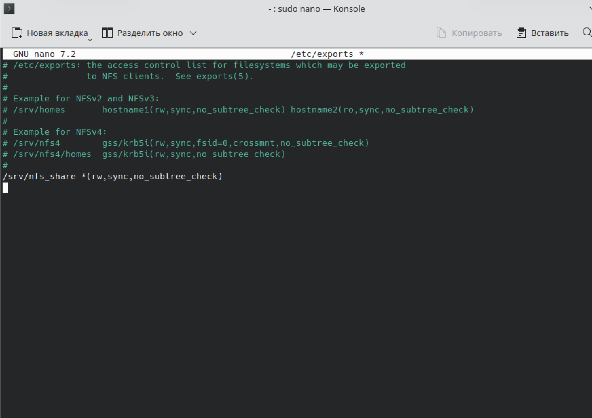

### 4. Проверка на сервере

ip a
ls -la /srv/nfs_share

IP-адрес сервера: 192.168.64.16/24. В шаре лежит файл test_from_client.txt (создан клиентом).

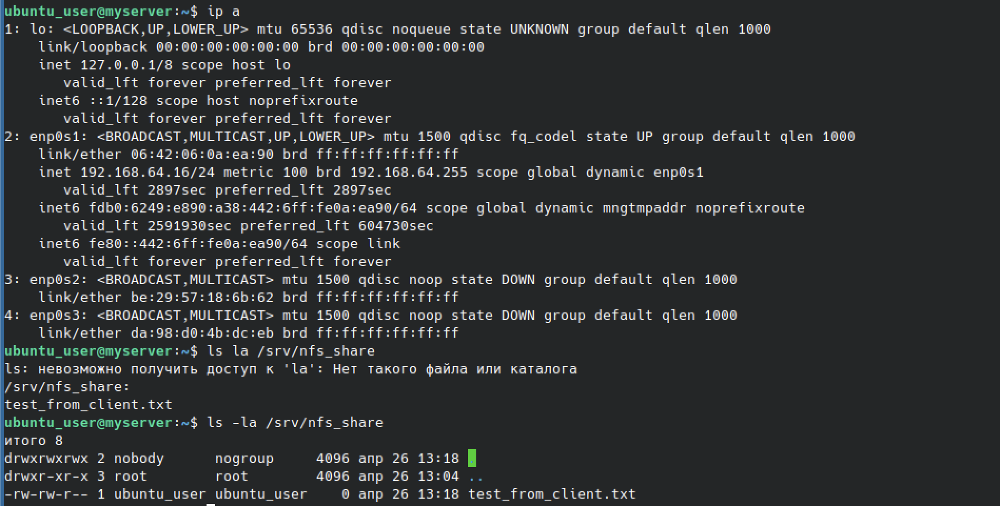

### 5. Установка NFS-клиента

sudo apt install nfs-common -y

Установлены пакеты: nfs-common, rpcbind, keyutils, libnfsidmap1.

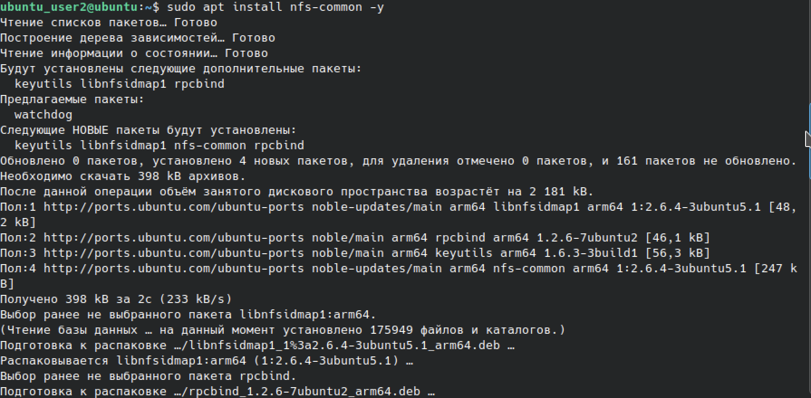

### 6. Монтирование NFS-шары на клиенте

sudo mkdir -p /mnt/nfs_client
ip a
sudo mount 192.168.64.16:/srv/nfs_share /mnt/nfs_client
ls -la /mnt/nfs_client
touch /mnt/nfs_client/test_from_client.txt

IP-адрес клиента: 192.168.64.17/24. Шара смонтирована, создан файл test_from_client.txt.

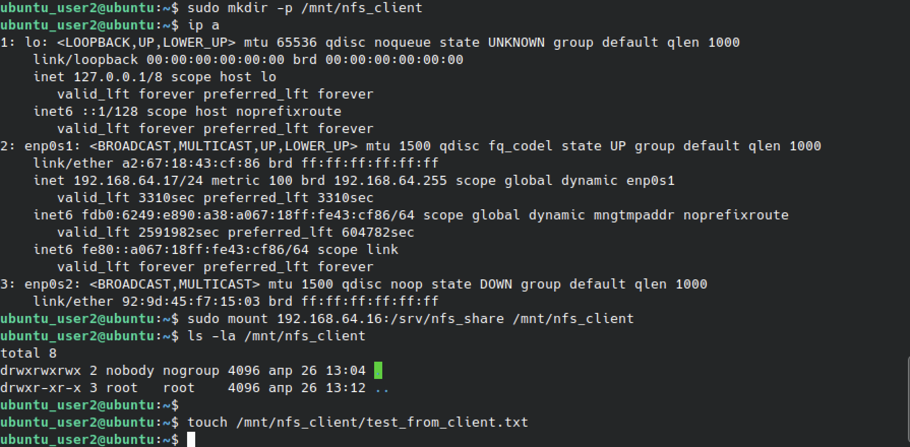

---

## 📸 Задание 2. Анализ DNS-пакетов

### 7. Установка Wireshark

sudo apt install wireshark -y

Установлены пакеты: wireshark, wireshark-common, libwiretap14t64, libwireshark17t64, libwsutil15t64 и другие.

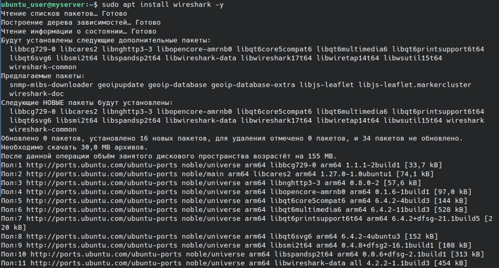

### 8. Добавление пользователя в группу wireshark

sudo usermod -a -G wireshark $USER

Пользователь добавлен в группу wireshark для запуска анализатора без sudo.

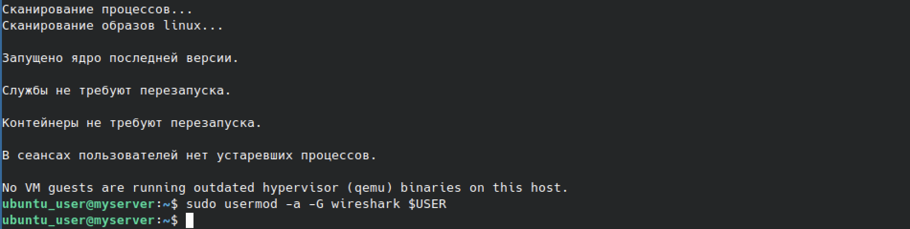

### 9. Фильтр в Wireshark

Запущен Wireshark, выбран интерфейс enp0s1. Применён фильтр:

dns.qry.name == "skillbox.ru"

В выводе видны DNS-пакеты: HTTPS-запрос, AAAA-запрос, ответы от DNS-сервера.

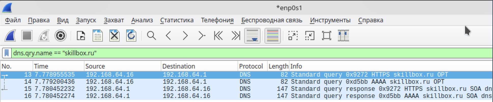

### 10. Анализ пакета — протокол и порты

Пакет 14:
- Protocol: UDP
- Src Port: 46435
- Dst Port: 53
- Length: 48

**Ответ на вопрос 1:** DNS-пакет отправлен по протоколу **UDP** (стандарт для DNS-запросов, порт 53).

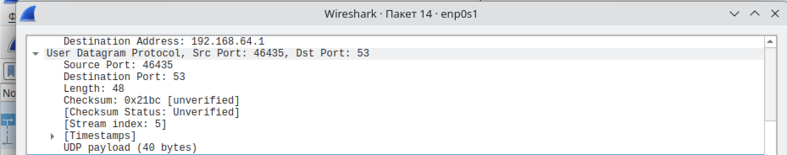

### 11. Анализ пакета — IP-адреса

Internet Protocol Version 4:
- Src: 192.168.64.16 (наш хост)
- Dst: 192.168.64.1 (DNS-сервер)

**Ответ на вопрос 2:** DNS-пакет отправлен на IP-адрес **192.168.64.1** — это шлюз/DNS-сервер в сети.

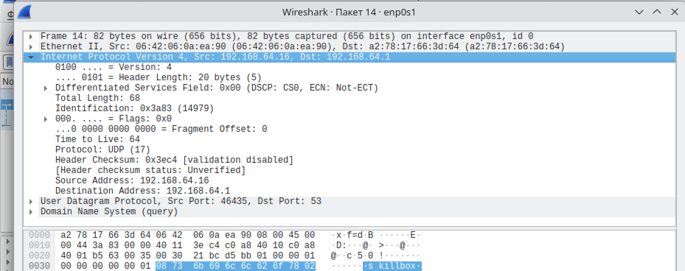

### 12. Анализ пакета — тип записи

Domain Name System (query):
- Transaction ID: 0xd5bb
- Queries: 1
- Name: skillbox.ru
- Type: AAAA (28) (IP6 Address)
- Class: IN

**Ответ на вопрос 3:** Запрашивается запись типа **AAAA** — это IPv6-адрес домена skillbox.ru.

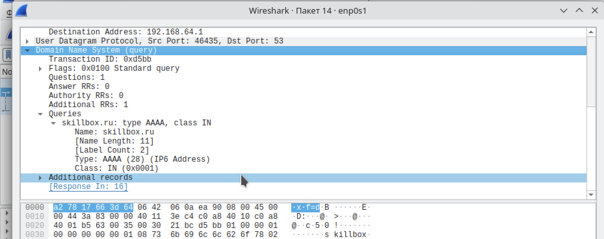

---

## 📊 Ответы на вопросы задания

1. **С помощью какого протокола был отправлен DNS-пакет — UDP или TCP?**
   Ответ: **UDP**. DNS-запросы обычно идут по UDP (порт 53) для скорости. TCP используется только для больших ответов или зонных передач.

2. **На какой IP-адрес отправлен DNS-пакет?**
   Ответ: **192.168.64.1** — это DNS-сервер (шлюз сети).

3. **Запись какого типа запрашивается?**
   Ответ: **AAAA** — запись IPv6-адреса для домена skillbox.ru.

---

## 📊 Выводы
- Освоена установка и настройка NFS-сервера и клиента.
- Отработано монтирование NFS-шары и проверка доступа.
- Изучена работа Wireshark с фильтрами для DNS-трафика.
- Проанализирован реальный DNS-пакет: определены протокол, IP-адреса и тип запроса.
- Понята разница между A и AAAA-записями DNS.

## 🧠 Чему научился
- Настройка /etc/exports и применение через exportfs.
- Монтирование NFS-шары по IP.
- Работа с Wireshark: захват, фильтрация, анализ пакетов.
- Разбор DNS-пакета по уровням: Ethernet, IP, UDP, DNS.
- Понимание, как DNS-сервер отвечает на запросы A и AAAA.
