# Практическая работа: iptables — фильтрация трафика

## 🎯 Цель работы
Научиться составлять правила iptables для блокировки/пропуска трафика по определённым признакам.

## 📋 Задание
1. Установить sshd на Ubuntu.
2. DROP по умолчанию в INPUT.
3. ACCEPT по умолчанию в OUTPUT + порт 80.
4. ACCEPT для SSH.
5. ACCEPT/DROP для INPUT/OUTPUT.
6. DROP INPUT & OUTPUT + ICMP-сценарии.
7. Ограничение одновременных SSH-подключений (connlimit).

## 🛠️ Использованные команды
- iptables -P — установка политики по умолчанию
- iptables -A — добавление правила
- iptables -L -n -v — просмотр правил
- iptables -F — очистка всех правил
- systemctl status ssh — статус SSH
- curl, ping, ssh — проверка соединений
- connlimit — ограничение подключений

---

## 📸 Задание 1. Установка sshd

### 1. Проверка статуса SSH

sudo systemctl status ssh

Служба SSH активна (active running), Main PID 3918. Сервер слушает порт 22 на всех интерфейсах.

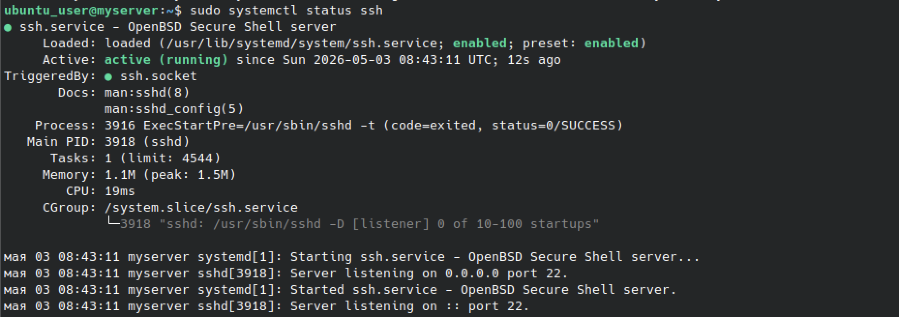

**Порт SSH: 22.**

---

## 📸 Задание 2. DROP по умолчанию в INPUT

### 2. Политика DROP для INPUT

sudo iptables -P INPUT DROP
sudo iptables -L -n -v

Политика INPUT установлена в DROP. Все входящие пакеты, не подпадающие под разрешающие правила, отбрасываются.

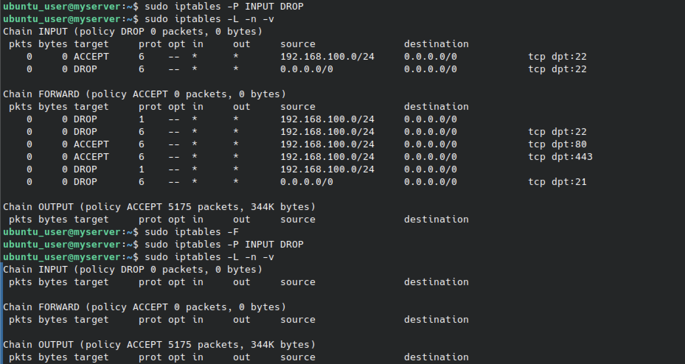

### Ответ на вопрос

**Может ли пользователь посетить google.com?**
**Нет.** Политика INPUT = DROP отбрасывает все новые входящие соединения. Ответные пакеты от веб-сервера будут отброшены.

**Как исправить?** Разрешить ответы на уже установленные соединения:

iptables -A INPUT -m state --state ESTABLISHED,RELATED -j ACCEPT

---

## 📸 Задание 3. ACCEPT по умолчанию в OUTPUT + порт 80

### 3. Разрешение входящего трафика на порт 80

sudo iptables -A INPUT -p tcp --dport 80 -j ACCEPT
sudo iptables -L -n -v

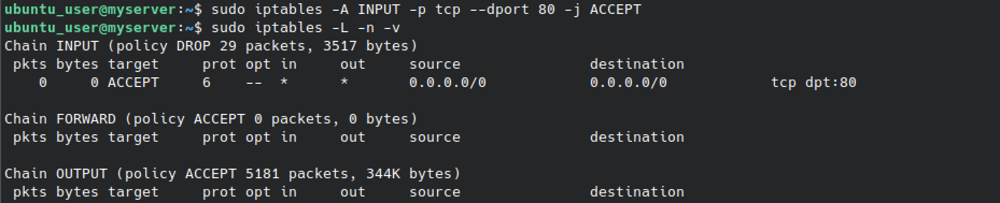

### Ответ на вопрос

**Можете ли вы посетить mail.ru?**
**Нет.** mail.ru использует HTTPS (443), а разрешён только порт 80.

**Что нужно изменить?** Добавить правило для порта 443:

iptables -A INPUT -p tcp --dport 443 -j ACCEPT

### 4. Добавление правила для порта 443

sudo iptables -A INPUT -p tcp --dport 443 -j ACCEPT
sudo iptables -L -n -v

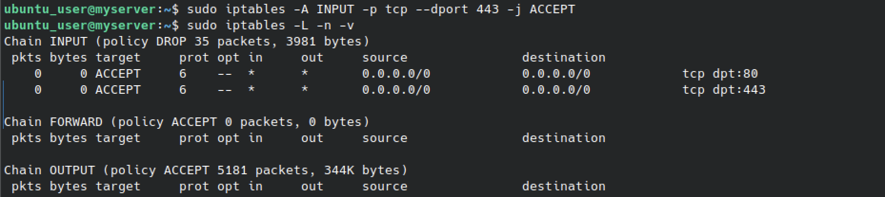

---

## 📸 Задание 4. ACCEPT для SSH

### 5. Разрешение входящего SSH

sudo iptables -A INPUT -p tcp --dport 22 -j ACCEPT
sudo iptables -L -n -v

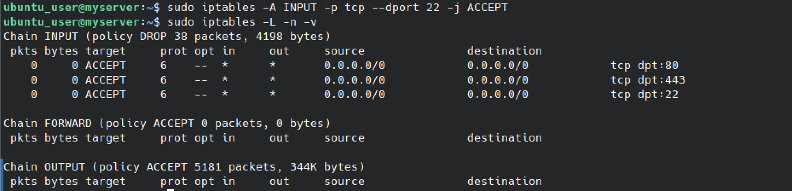

### 6. Проверка SSH-подключения

С другой виртуальной машины:

ssh ubuntu_user@192.168.64.16

Подключение успешно — приветствие Ubuntu 24.04.4 LTS.

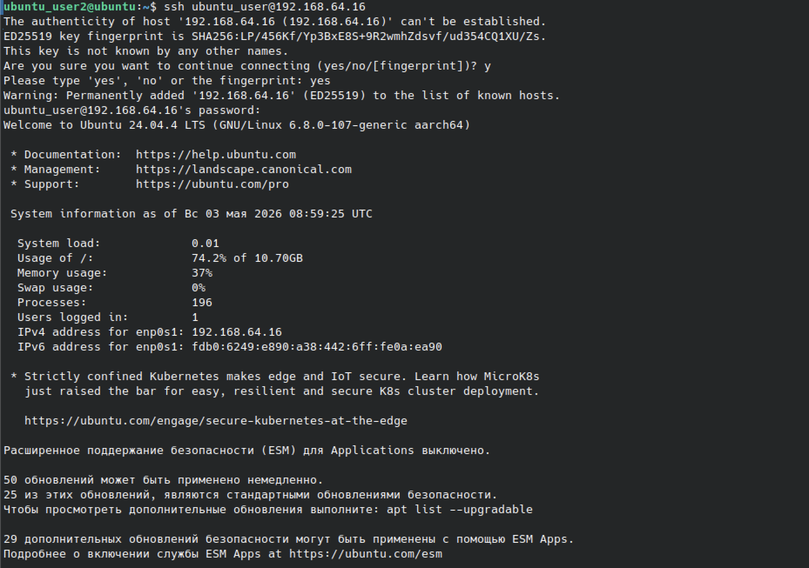

---

## 📸 Задание 5. ACCEPT/DROP для INPUT/OUTPUT

### 7. Проверка ESTABLISHED,RELATED

sudo iptables -F
sudo iptables -P INPUT DROP
sudo iptables -P OUTPUT ACCEPT
sudo iptables -A INPUT -m state --state ESTABLISHED,RELATED -j ACCEPT
sudo iptables -L -n -v
curl -I google.com
ping -c 2 8.8.8.8

curl не работает — DNS-запрос блокируется. ping до 8.8.8.8 работает.

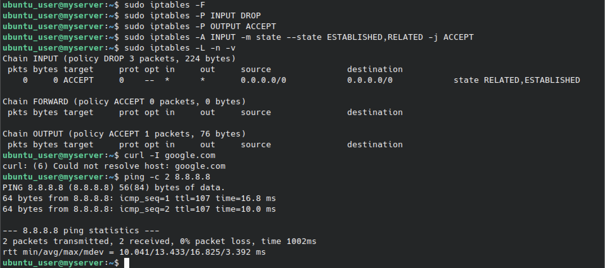

### 8. Список правил после ESTABLISHED

sudo iptables -L -n -v

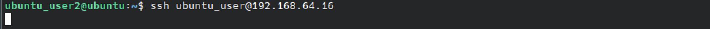

### 9. Повторная попытка SSH

Соединение устанавливается, так как SSH-сессия инициирована локальной машиной.

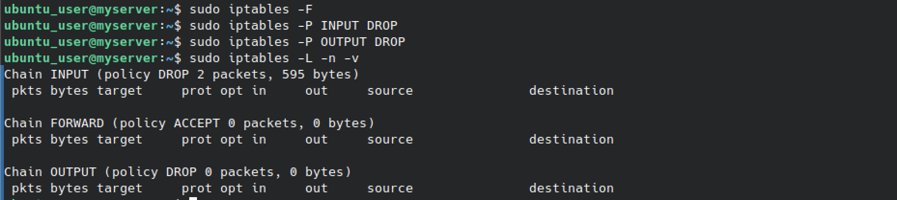

### 10. DROP для обеих цепочек

sudo iptables -F
sudo iptables -P INPUT DROP
sudo iptables -P OUTPUT DROP
sudo iptables -L -n -v

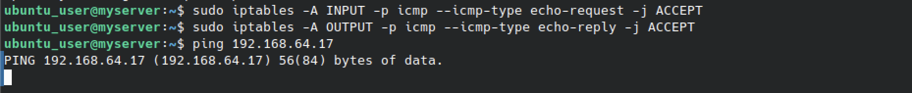

### Ответ на вопрос

**Почему набор правил работает?**
Политика INPUT = DROP блокирует все новые входящие. Политика OUTPUT = ACCEPT разрешает исходящие. Правило ESTABLISHED,RELATED пропускает ответные пакеты. Сеансы, инициированные локальной машиной, работают, а новые входящие — блокируются.

---

## 📸 Задание 6. DROP INPUT & OUTPUT + ICMP

### Сценарий (a) — только удалённые могут пинговать локальную

### 11. Правила для сценария (a)

sudo iptables -F
sudo iptables -P INPUT DROP
sudo iptables -P OUTPUT DROP
sudo iptables -A INPUT -p icmp --icmp-type echo-request -j ACCEPT
sudo iptables -A OUTPUT -p icmp --icmp-type echo-reply -j ACCEPT
sudo iptables -L -n -v
ping 192.168.64.17

Локальная машина не может инициировать ping, но может отвечать.

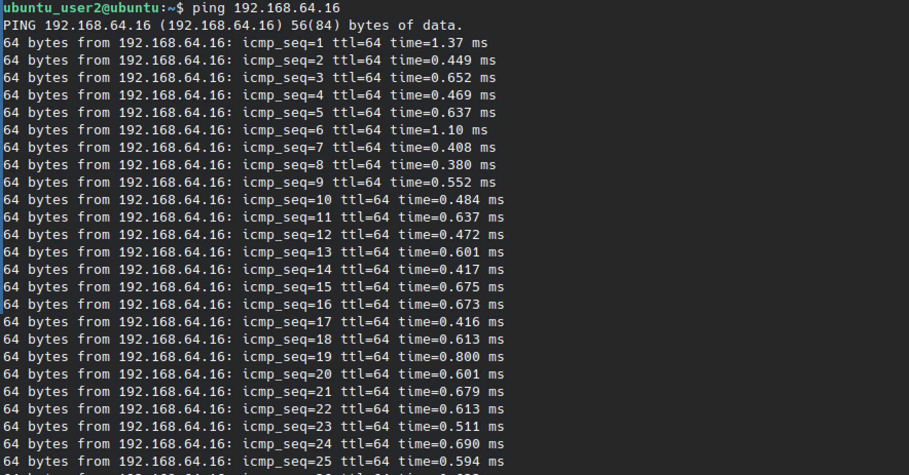

### 12. Проверка с удалённой машины

ping 192.168.64.16

Удалённая машина успешно пингует локальную.

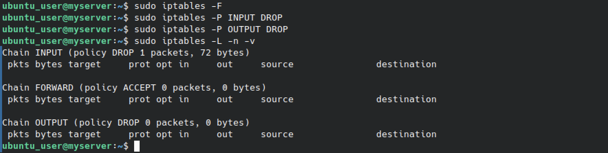

### Сценарий (b) — только локальная может пинговать удалённые

### 13. Сброс правил

sudo iptables -F
sudo iptables -P INPUT DROP
sudo iptables -P OUTPUT DROP
sudo iptables -L -n -v

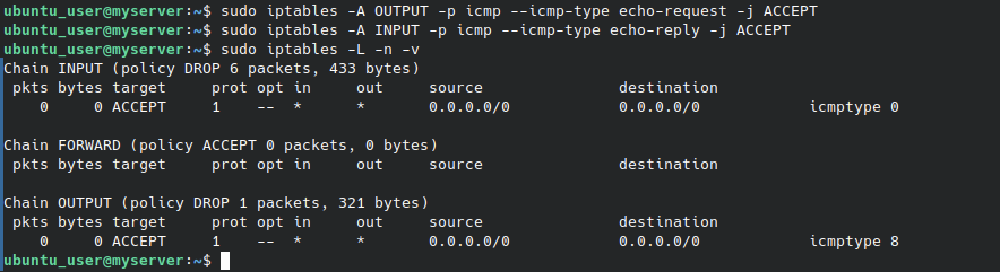

### 14. Правила для сценария (b)

sudo iptables -A OUTPUT -p icmp --icmp-type echo-request -j ACCEPT
sudo iptables -A INPUT -p icmp --icmp-type echo-reply -j ACCEPT
sudo iptables -L -n -v

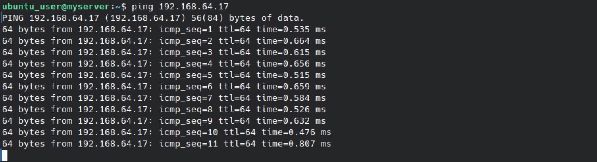

### 15. Проверка с локальной машины

ping 192.168.64.17

Пинг проходит успешно.

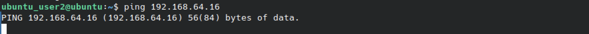

### Сценарий (c) — ping в оба направления

### 16. Правила для обоих направлений

Разрешены echo-request и echo-reply в обеих цепочках.

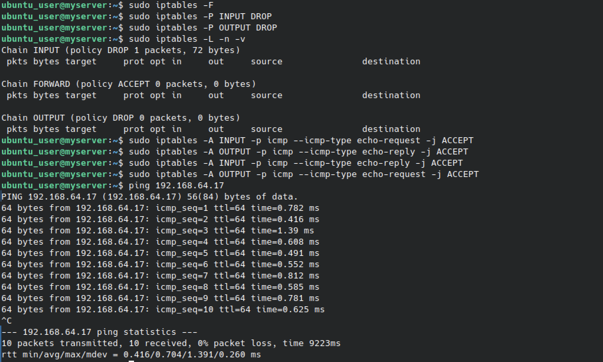

### 17. Проверка ping в оба направления

С локальной машины: ping 192.168.64.17 — успешно.
С удалённой машины: ping 192.168.64.16 — успешно.

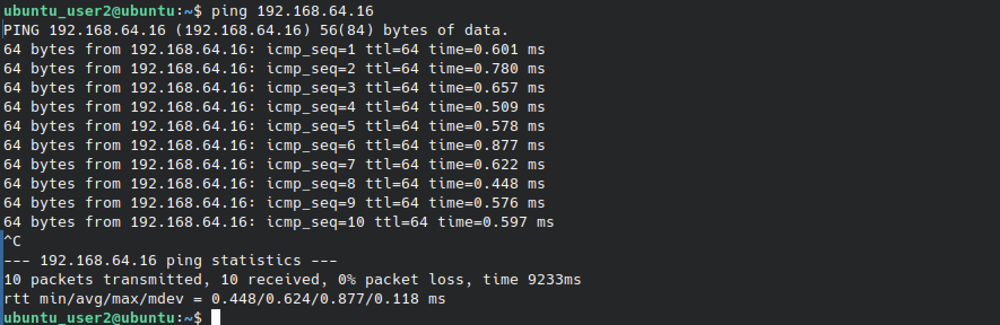

---

## 📸 Задание 7. Ограничение одновременных SSH-подключений (connlimit)

### 18. Правила connlimit

sudo iptables -F
sudo iptables -P INPUT DROP
sudo iptables -P OUTPUT ACCEPT
sudo iptables -A INPUT -p tcp --dport 22 -m connlimit --connlimit-above 2 -j DROP
sudo iptables -A INPUT -p tcp --dport 22 -j ACCEPT
sudo iptables -L -n -v

### 19. Первое и второе подключение

ssh ubuntu_user@192.168.64.16 — проходит успешно.

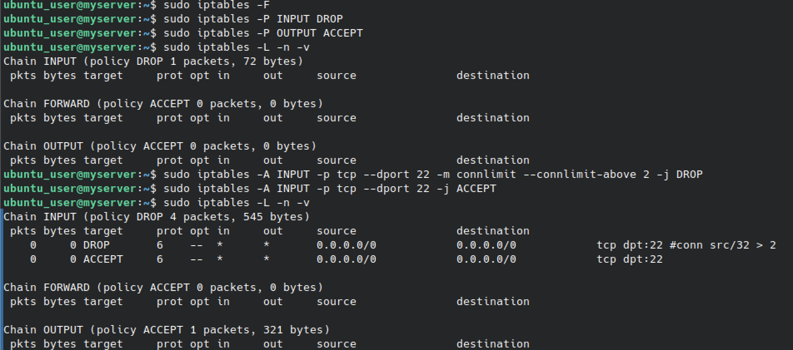

### 20. Попытка третьего подключения

Третье подключение зависает — правило connlimit срабатывает.

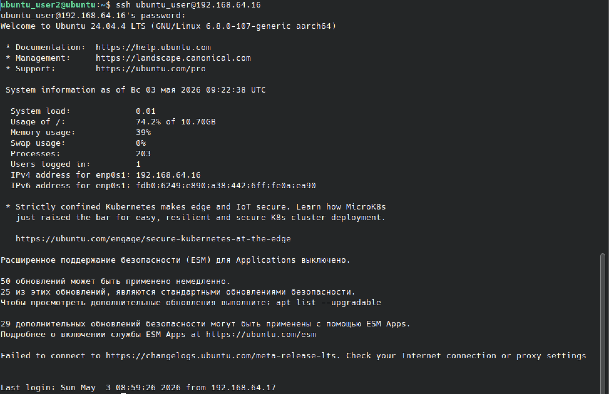

### 21. Дополнительный скриншот

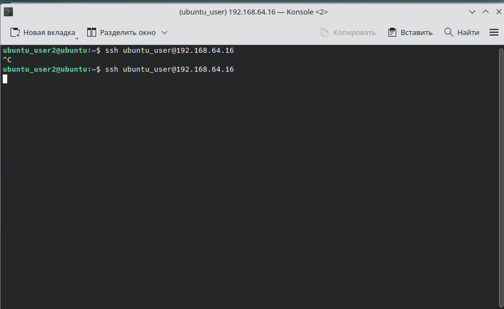

---

## 📊 Выводы
- Освоена работа с iptables: политики, правила, цепочки.
- Изучены политики DROP/ACCEPT для INPUT и OUTPUT.
- Отработана фильтрация по портам (80, 443, 22).
- Изучено состояние ESTABLISHED,RELATED для пропуска ответных пакетов.
- Отработаны ICMP-сценарии: ping в одну сторону, в другую, в оба направления.
- Освоено ограничение одновременных SSH-подключений через connlimit.
- Понята логика работы брандмауэра.

## 🧠 Чему научился
- Настройка политик по умолчанию для цепочек INPUT/OUTPUT/FORWARD.
- Добавление и удаление правил фильтрации.
- Разрешение/блокировка по протоколу, порту, состоянию соединения.
- Работа с модулями iptables: state, connlimit, icmp.
- Диагностика: curl, ping, ssh.
