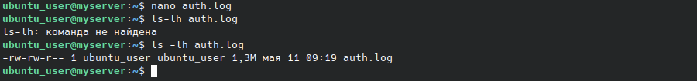
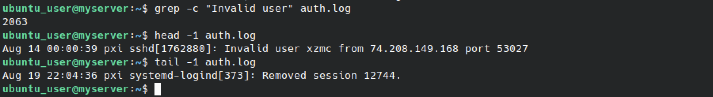
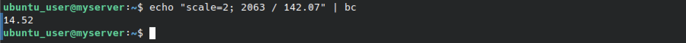
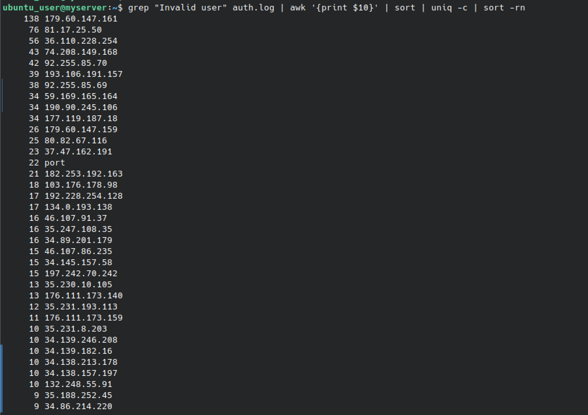
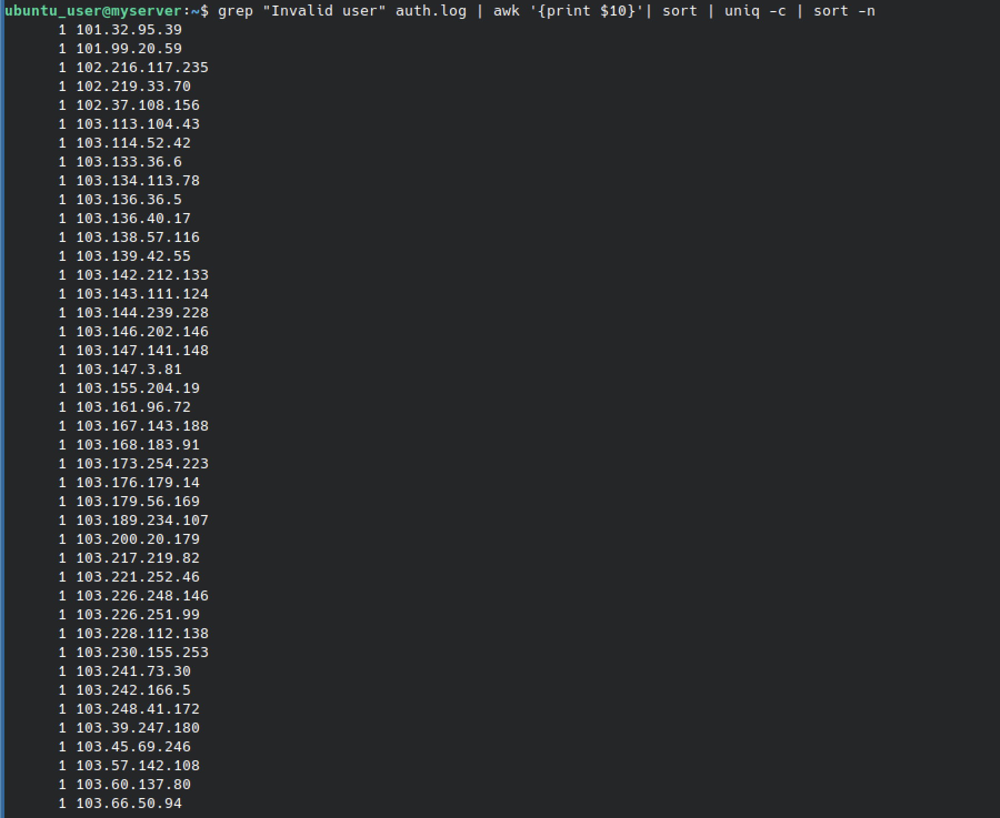
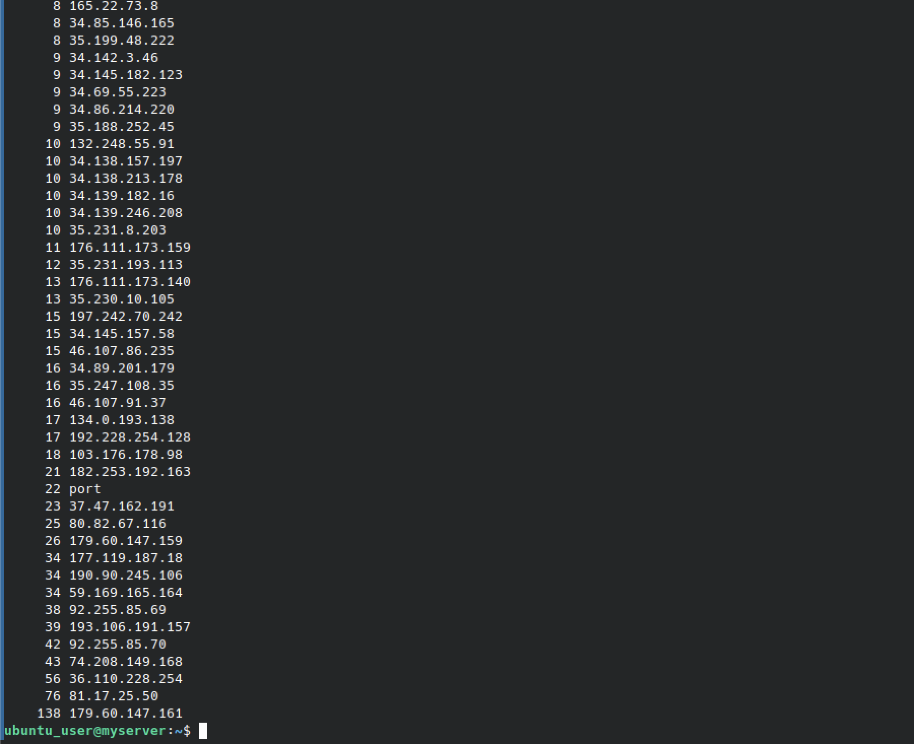

# Практическая работа: Анализ логов внешнего SSH-сервера

## 🎯 Цель работы
Научиться анализировать логи внешнего сервиса, выявлять попытки компрометации SSH и определять источники атак.

## 📋 Задание
1. Определить количество попыток компрометации с паттерном «Invalid user» и среднее число атак в час.
2. Определить IP-адрес, с которого было больше всего попыток.

## 🛠️ Использованные команды и утилиты
- grep — поиск строк по паттерну
- wc / grep -c — подсчёт строк
- head / tail — первая и последняя запись
- awk — извлечение столбца с IP-адресом
- sort / uniq -c — сортировка и подсчёт уникальных значений

---

## 📸 Задание 1. Попытки компрометации внешнего SSH-сервера

### 1. Проверка лог-файла

nano auth.log
ls -lh auth.log

Файл auth.log скопирован на сервер. Размер — 1,3 МБ, создан 11 мая.

### 2. Подсчёт записей «Invalid user» и определение первой/последней записи

grep -c "Invalid user" auth.log
head -1 auth.log
tail -1 auth.log

**Результаты:**
- Количество строк с паттерном **Invalid user**: **2063**
- Первая запись: **Aug 14 00:00:39 pxi sshd[1762880]: Invalid user xzmc from 74.208.149.168 port 53027**
- Последняя запись в файле: **Aug 19 22:04:36 pxi systemd-logind[373]: Removed session 12744**

### Расчёт среднего числа атак в час

Период наблюдения: с 14 августа 00:00 до 19 августа 22:04.
Длительность: **5 суток 22 часа 4 минуты ≈ 142 часа.**

Среднее число атак в час:

2063 / 142 ≈ 14,5 атак в час

**Среднее число атак: ≈ 14–15 в час** (≈ 348 в сутки).

---

## 📸 Задание 2. Определение IP-адреса

### 3. Топ IP-адресов атакующих (по убыванию)

grep "Invalid user" auth.log | awk '{print $10}' | sort | uniq -c | sort -rn

**Топ-5 атакующих IP-адресов:**

| Количество попыток | IP-адрес |
|--------------------|----------|
| 138 | 179.60.147.161 |
| 76 | 81.17.25.50 |
| 56 | 36.110.228.254 |
| 43 | 74.208.149.168 |
| 42 | 92.255.85.70 |

### 4. Таблица IP-адресов (нижняя часть, по возрастанию)

grep "Invalid user" auth.log | awk '{print $10}' | sort | uniq -c | sort -n

Нижняя часть таблицы — IP-адреса с одной попыткой (однократные сканирования). Начинается с 101.32.95.39.

### 5. Таблица IP-адресов (середина)

Середина таблицы — IP-адреса с числом попыток от 8 до 43.

### 6. Полная таблица IP-адресов

Полный список IP-адресов атакующих с числом попыток. Внизу — максимальный: **138 179.60.147.161**.

### Ответ на вопрос

**IP-адрес, с которого было больше всего атак:**
**179.60.147.161** — 138 попыток компрометации.

---

## 📊 Выводы
- Освоен анализ лог-файла auth.log с помощью текстовых утилит.
- Определено количество попыток компрометации SSH по паттерну «Invalid user»: **2063**.
- Рассчитано среднее число атак в час: **≈ 14–15**.
- Выявлен IP-адрес с наибольшим числом попыток: **179.60.147.161** (138 попыток).
- Отработана связка команд: `grep | awk | sort | uniq -c | sort -rn`.

## 🧠 Чему научился
- Поиск и подсчёт событий по паттерну через grep.
- Извлечение IP-адресов из логов через awk.
- Подсчёт уникальных значений через sort и uniq -c.
- Определение топ-атакующих через сортировку по убыванию.
- Расчёт интенсивности атак на основе временных меток.
- Понимание важности анализа логов для выявления инцидентов за периметром сети.

## 🔐 Практическая значимость
Анализ логов SSH — базовый навык администратора безопасности. Понимание того, кто и как часто пытается атаковать сервер, позволяет:
- блокировать наиболее агрессивные IP через iptables/fail2ban;
- оценивать интенсивность сканирования;
- определять географию атак;
- настраивать пороги для алертинга.
